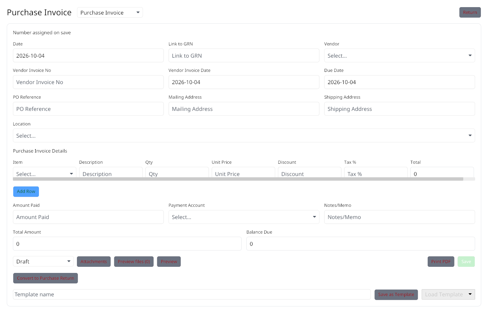
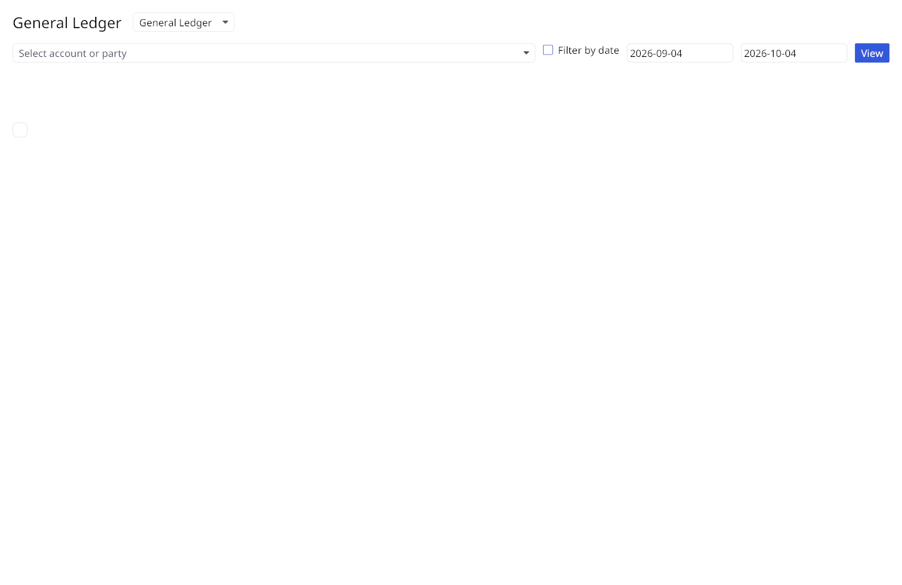

# MemonBook Complete Project User Guide

**Implementation reviewed:** 4 October 2026  
**Scope:** Desktop screens and workflows implemented in this repository. This guide describes current behavior, including incomplete and misleading controls. It does not describe planned behavior.

## Counting conventions

Field counts mean user-facing data-entry fields. A radio-button pair is one field, a two-part date range is two fields, status toggles count as fields, and transaction counts include the one initially displayed item row plus the Attachments control. Hidden implementation IDs, row serial numbers, selection checkboxes, headings, table display columns, and action buttons are not fields. A transaction Add/Edit form count changes when more item rows are added or receipt-type fields are hidden. Maintain item stock adds one quantity field for each active location. Custom fields are additional and have no fixed maximum in the UI.

Unique action counts count distinct buttons and row/header gestures once. Search boxes, filters, and other data-entry fields are listed separately. A table's repeated row checkboxes count as one action type. Add and Edit use the same form unless stated otherwise. There is no separate read-only Details form: supported double-click actions open the editable form.

## Project overview

MemonBook is a local desktop application built with Python and PyQt6. It combines expense and trip entry, business master records, purchase and sales documents, payroll, and accounting reports. The visible window starts on Home and has seven mounted pages: Home, Transactions, Accounting, Trips, Maintain, Payroll, and Settings. Support is a sidebar label without a page or click handler.

The app stores its records in JSON files under `data/`. A successful save writes to disk immediately. There is no database server, sign-in screen, backup screen, or synchronization service in the user interface. Expense amounts and several dashboard figures are displayed with a euro symbol, but transaction and payroll forms do not have a general currency selector.

Start the app from the project folder with `python main.py`.

### Navigation

| Sidebar entry | Opens | Notes |
|---|---|---|
| Home | Dashboard | New Expense and New Trip open dialogs. |
| Transactions | Purchase, Sale, and Transaction documents | Use the green type button to cycle between the three groups, then choose a document type. |
| Accounting | General Ledger, Trial Balance, or AR / AP | Choose a report from the dropdown. |
| Trips | Trip list | New Trip opens the trip form. |
| Maintain | Chart of Accounts, Vendors, Items, Customers, or Inventory Locations | Choose a master-data page from the dropdown. |
| Payroll | Payroll list | Employee opens the employee-maintenance screen. |
| Settings | Placeholder | No settings can currently be changed. |
| Support | No page | The label is not connected to an action. |

The page content changes when selected, but the highlighted sidebar item can be wrong after navigating. The page index is compared with the button's display order, which differs after Accounting was inserted. Use the visible page title to confirm the current page.

## User roles and access

| Role or access level | What the implementation allows |
|---|---|
| Signed-in user | No sign-in or role selection exists. The profile name shown in the sidebar is fixed in code and does not control access. |
| Manager, approver, employee, or administrator | No role-specific screen, field, button, or permission check is implemented. Every person using the application can reach the same mounted pages and actions. |
| Approval workflow | Approval records can exist in storage and affect a dashboard count, but there is no approval inbox, approve/reject action, reassignment screen, or email notification. Transaction statuses can be selected without an approval role. |

Treat the local data folder as sensitive. Employee, vendor, customer, bank, attachment, and accounting information is stored locally as JSON and files. No password, API key, or external service credential is required by the implemented UI.

## Module-by-module feature documentation

### Home dashboard

**Purpose and location:** Select Home in the sidebar. It summarizes a few stored counts and recent expenses and offers quick access. There are no access restrictions.

**Fields:** 0 data-entry fields.

**Actions:** 4 buttons. `+ New expense` opens Expense. `+ Create trip` opens Trip. `+ Add receipt` and `+ Create report` have no connected action and do nothing when selected.

**Lists and status values:** Recent Expenses shows at most five records with Subject, Employee, Team, and Amount. It is read-only, has no search, filter, sort, pagination, or row actions. Pending Tasks shows Pending Approvals, New Trips Registered, Unreported Expenses, Upcoming Expenses, and Unreported Advances. The trips figure is the total trip count, not a new-trip status. Upcoming Expenses is not calculated and remains zero. Unreported Advances is hard-coded to EUR 0.00. The two chart areas are placeholders; they do not render charts from stored statistics.

**Messages:** Opening or saving a dialog does not create dashboard notifications. Successful expense/trip saves close the dialog without a success popup.

*Caption: The two chart panels are still placeholders. The sidebar profile is replaced with a fictional label for this screenshot.*

### Expenses

**Purpose and location:** Home > `+ New expense`. Expenses can be saved as Draft or as an unsubmitted expense. The list is not available as a dedicated page, so this dialog does not offer edit, delete, receipt preview, approval, or report management.

**Form fields (10):**

| Field | Type and entry | Required, options, default, and rules |
|---|---|---|
| Subject | Text | Marked required. Save checks that it is not blank. No length limit is set. |
| Merchant | Text | Marked required. Save checks that it is not blank. |
| Date | Calendar date picker | Marked required; defaults to today; the widget supplies a valid date. Display format is day/month/year. |
| Total | Text/numeric-looking input | Marked required; must be nonblank and parse as a floating-point number. No non-negative or precision limit is enforced. |
| Currency | Dropdown | Optional. EUR is the default; options are EUR, USD, GBP, PKR. |
| Reimbursable | Checkbox | Optional; unchecked by default. Stored as 0 or 1. |
| Category | Dropdown | Marked required but no save validation; defaults to Travel. Options: Travel, Food, Office Supplies, Accommodation, Entertainment, Other. |
| Description | Multiline text | Optional; no limit is set. |
| Employee | Text | Marked required and checked for nonblank text. It is not selected from Employee records. |
| Add to report | Yes/No checkbox pair | Yes is selected by default. Selecting one selects the other as false. A report name is not entered; Yes stores the fixed text `November_2022`. |

**Actions (2):** `Save draft` and `Save`. Both run the same validation, so the fields Subject, Merchant, Total, and Employee are required for either action. `Save draft` stores status Draft and no report. `Save` stores status Not Submitted and stores the fixed report name if Yes is selected. Both persist the expense and close the dialog. A failed required/numeric check returns without a message. The dialog does not upload a receipt despite the Home button label `Add receipt`; there is no receipt-path picker here.

**Workflow and data shown:** Enter the fields, choose the report and reimbursable options, then save. Recent Expenses reads the last five by expense date. It shows the amount with a euro prefix even when another currency is selected. Team is saved as blank by this form. No row editing or deletion is exposed.

### Trips

**Purpose and location:** Trips in the sidebar show all saved business trips. Home > `+ Create trip` and Trips > `+ New Trip` open the same form.

**Trip form fields (12):**

| Field | Type and entry | Required, options, default, and rules |
|---|---|---|
| Name | Text | Marked required; Save rejects blank. Draft substitutes `Untitled Trip` when blank. |
| Type | Radio pair | Marked required; Domestic or International. International is the default. |
| Purpose | Multiline text | Marked required in the label, but not checked before saving. |
| Flight | Radio pair | One-way or Roundtrip; Roundtrip is the default. This selection is not stored. |
| Depart from | Text | Marked required and checked by Save; Draft does not check it. |
| Departure Date | Calendar date picker | Optional label; defaults to today. |
| Destination | Text | Marked required and checked by Save; Draft does not check it. |
| Return Date | Calendar date picker | Optional label; defaults to seven days after today. |
| Budget limit | Text | Marked required but not validated as a number before conversion. Blank becomes 0. Invalid nonblank text can raise an error instead of showing a validation message. |
| Check-in | Calendar date picker | Marked required but not validated; defaults to today. |
| Check-out | Calendar date picker | Marked required but not validated; defaults to seven days after today. |
| Hotel | Text | Marked required but not checked before saving. |

**Actions (2):** `Save draft` and `Save`. Save checks Name, Depart from, and Destination only, then stores a trip. Draft bypasses those checks, stores a blank trip name as Untitled Trip, and uses the same trip record structure. Neither action creates a draft status. Successful saves close the dialog. Validation failure has no message. There is no confirmation, edit, delete, archive, restore, or approval action.

**Trips list:** 0 data-entry fields; one `+ New Trip` action. Columns are Name, Type, Destination, Dates, Budget, and Hotel. Dates combine departure and return. Budget is always prefixed with EUR. The table is read-only and has no search, filters, sorting, pagination, status, or row actions.

### Transactions

**Purpose and location:** Sidebar > Transactions. This module records purchase documents, sales documents, and cash/bank/accounting vouchers. Select the group with the Purchase/Sale/Transaction button and select a subtype from the adjacent dropdown. The active master records in Maintain populate party, account, item, and location selectors. If there are no accounts, a banner asks users to add them first.

There are 14 subtype forms. Add uses the form described below. Double-click a saved row to edit it unless its status is Posted or Cancelled. There is no separate read-only Details view. The fields below describe the form's header, one initial line-item row, bottom fields, and attachment control. Adding item rows repeats the row fields and increases the live field count by one row's editable controls. The user may leave most fields blank; the UI does not perform general required-field validation.

**Common field behavior:** Number fields are generated and read-only. Date fields use a calendar picker, default to today, and display day/month/year. Status defaults to Draft; options are Draft, Pending Approval, Approved, Posted, and Cancelled. Vendor, Customer, Account, Item, and Location selectors contain active master records and save a hidden master ID with the displayed name. Account choices are not filtered by account type. Legacy names without a matching master record can remain as unlinked text when reopening older records. Mailing addresses populated from a vendor are read-only; shipping addresses are editable.

Text areas are used for notes, terms, narration, reason, and address fields. Other ordinary header and row fields are line edits or editable table cells. Price Type options are Retail, Wholesale, and Custom. Shipping Via options are Road, Air, Sea, and Courier. Receipt Type options are Party, Petty, and Multiparty. Payment Mode options are Cash, Cheque, NEFT, RTGS, and UPI. Voucher Type options are Adjustment, Transfer, Accrual, Opening, and Closing. In receipt/payment forms, Receipt Type can hide header fields: Party hides Contra Account; Petty hides Customer or Vendor; Multiparty hides both. The customer/vendor line-item column remains available. These options do not impose a role or required-field rule.

| Subtype | Header fields | One line-item row | Bottom fields | Fields in Add/Edit form | Conditional fields |
|---|---|---|---|---:|---|
| Purchase Order | PO No (auto), PO Date, Vendor, Reference No, Mailing Address, Shipping Address, Shipping Date, Shipping Via | Item, Qty, Rate, Amount, Tax %, Total | Total Qty, Total Discount, Total Amount, Terms & Conditions, Notes/Memo, Status | 21 | Address population; generated PO number. |
| Purchase Invoice | PI No (auto), PI Date, Link to GRN, Vendor, Vendor Invoice No., Vendor Invoice Date, Due Date, PO Reference, Mailing Address, Shipping Address | Item, Description, Qty, Unit Price, Discount, Tax%, Total | Amount Paid, Payment Account, Notes/Memo, Status, Total Amount, Balance Due | 24 | Linked GRN/PO text fields are populated by conversion, not a picker. Mailing Address is read-only after vendor selection. |
| Purchase Return | Return Number (auto), Return Date, Vendor, Purchase Invoice, Mailing Address, Shipping Address, Reason for Return | Item, Description, Orig. Qty, Return Qty, Unit Price, Tax%, Total | Refund Amount, Refund Account, Notes/Memo, Status, Total Amount | 20 | Vendor address behavior. Convert from Purchase Invoice. |
| Goods Receipt | GRN Number (auto), GRN Date, Link to PO, Vendor, Vendor Invoice No., Receiving Location, Mailing Address, Shipping Address | Item, Description, Ordered, Recevied, Accpeted, Rejected, Unit Cost, Total | Total Recevied, Total Accpeted, Total Rejected, Total Amount, Note/Memo, Status | 23 | A new saved receipt adds Accepted quantity to the selected location. Edits do not reapply stock. |
| Cash Receipt | Receipt Type, Voucher No. (auto), Date, Customer, Mailing Address, Shipping Address, Contra Account, Cash Account (with Balance), Reference, Narration | Customer, Amount, Invoices | Total Amount, Note/Memo, Status | 17 | Default Party mode hides Contra Account (16 visible). Petty hides header Customer; Multiparty hides Customer and Contra Account. |
| Bank Receipt | Receipt Type, Voucher No. (auto), Date, Customer, Contra Account, Mailing Address, Shipping Address, Bank Account (with Balance), Payment Mode, Cheque No, Cheque Date, Drawee Bank, Reference, Narration | Customer, Amount, Invoices | Total Amount, Note/Memo, Status | 21 | Default Party mode hides Contra Account (20 visible). Petty/Multi-party hide the same party fields as Cash Receipt. |
| Cash Payment | Receipt Type, Voucher No. (auto), Date, Vendor, Mailing Address, Shipping Address, Contra Account, Cash Account (with Balance), Reference, Narration | Vendor, Amount, WHT, WHT Amt, Net Amount, Invoices | Total Amount, WHT Rate %, WHT Amount, Net Amount to Pay, Note/Memo, Status | 23 | Default Party mode hides Contra Account (22 visible). Petty hides Vendor; Multiparty hides Vendor and Contra Account. |
| Bank Payment | Receipt Type, Voucher No. (auto), Date, Vendor, Mailing Address, Shipping Address, Contra Account, Bank Account (with Balance), Payment Mode, Cheque No, Cheque Date, Drawee Bank, Reference, Narration | Vendor, Amount, WHT, WHT Amt, Net Amount, Invoices | Total Amount, WHT Rate %, WHT Amount, Net Amount to Pay, Note/Memo, Status | 27 | Default Party mode hides Contra Account (26 visible). Petty/Multi-party hide the same party fields as Cash Payment. |
| Journal Voucher | Doc No (auto), Date, Voucher Type, Reference, Narration | Account, Narration, Debit (Dr), Credit (Cr) | Note/Memo, Status | 12 | Account rows use active Chart of Accounts. A live debit/credit balance label is read-only. |
| Quotation | Quotation Number (auto), Quotation Date, Valid Until, Customer, Customer Ref, Mailing Address, Shipping Address | Item, Description, Qty, Price Type, Unit Price, Discount, Tax%, Total | Terms & Conditions, Notes/Memo, Status, Total Amount | 20 | Mailing address may be blank for customers because the customer lookup reads an `Address` key that the customer form does not store. |
| Sale Order | Order Number (auto), Order Date, Link to Quotation, Customer, Customer PO, Delivery Date, Delivery Address | Item, Description, Qty, Price Type, Unit Price, Discount, Tax%, Total | Terms & Conditions, Notes/Memo, Status, Total Amount | 20 | Delivery Address may be populated from the selected customer. A saved order shows a read-only delivery summary. |
| Delivery Challan | DC Number (auto), DC Date, Link to Sale Order, Customer, Vehicle No, Driver Name, Driver Phone, Delivery Address, Location | Item, Description, Ordered Qty, Delivered Qty, Unit Price, Total | Note/Memo, Status, Total Amount | 19 | New challans reduce stock at Location by Delivered Qty. Edits do not reapply stock. |
| Sale Invoice | Invoice Number (auto), Invoice Date, Link to Delivery Challan, Link to Sale Order, Customer, Due Date, Location, Delivery Address | Item, Description, Qty, Price Type, Unit Price, Discount, Tax%, Total | Amount Received, Payment Account, Notes/Memo, Status, Total Amount, Balance Due | 23 | New invoices reduce stock by Qty only when no delivery challan is linked. Customer address lookup has the limitation noted above. |
| Sale Return | Return Number (auto), Return Date, Customer, Sale Invoice, Delivery Address, Reason for Return | Item, Description, Orig. Qty, Return Qty, Unit Price, Tax%, Total | Refund Amount, Refund Account, Notes/Memo, Status, Total Amount | 19 | Convert from Sale Invoice. No stock adjustment is implemented for returns. |

The form counts above include the generated number and Status controls, the initially shown row, and Attachments. `full` in the layout configuration is an invisible spacing placeholder, not a user field. The transaction list columns for each subtype are listed below. S.No and a selection checkbox appear first. The Columns control changes which optional columns are visible; there are no row action buttons. The Purchase Invoice list uses the configured label `Link to GRN Sami`, while its form label is `Link to GRN`. The GRN list/configuration uses the spellings `Recevied`, `Accpeted`, and `Total Recevied` as shown in the UI.

**Transaction table columns:**

- Purchase Order: PO No, PO Date, Vendor, Reference No, Mailing Address, Shipping Address, Shipping Date, Shipping Via, Item, Qty, Rate, Amount, Tax %, Total, Notes/Memo, Attachments, Status, Create Timestamp, Modified Timestamp.
- Purchase Invoice: PI No, PI Date, Link to GRN Sami, Vendor, Vendor Invoice No., Vendor Invoice Date, Due Date, PO Reference, Item, Description, Qty, Unit Price, Discount, Tax%, Total, Total Amount, Balance Due, Amount Paid, Payment Account, Notes/Memo, Attachments, Status, Create Timestamp, Modified Timestamp.
- Purchase Return: Return Number, Return Date, Vendor, Purchase Invoice, Reason for Return, Item, Description, Orig. Qty, Return Qty, Unit Price, Tax%, Total, Total Amount, Refund Amount, Refund Account, Notes/Memo, Attachments, Status, Create Timestamp, Modified Timestamp.
- Goods Receipt: GRN Number, GRN Date, Link to PO, Vendor, Vendor Invoice No., Receiving Location, Item, Description, Ordered, Recevied, Accpeted, Rejected, Unit Cost, Total, Total Recevied, Total Accpeted, Total Rejected, Total Amount, Note/Memo, Attachments, Status, Create Timestamp, Modified Timestamp.
- Cash Receipt: Receipt Type, Voucher No, Date, Customer, Contra Account, Cash Account (with Balance), Reference, Narration, Customer, Amount, Invoices, Total Amount, Note/Memo, Attachments, Status, Create Timestamp, Modified Timestamp.
- Bank Receipt: Receipt Type, Voucher No, Date, Customer, Contra Account, Bank Account (with Balance), Payment Mode, Cheque No, Cheque Date, Drawee Bank, Reference, Narration, Customer, Amount, Invoices, Total Amount, Note/Memo, Attachments, Status, Create Timestamp, Modified Timestamp.
- Cash Payment: Receipt Type, Voucher No, Date, Vendor, Contra Account, Cash Account (with Balance), Reference, Narration, Vendor, Amount, WHT, WHT Amt, Net Amount, Invoices, Total Amount, WHT Rate %, WHT Amount, Net Amount to Pay, Note/Memo, Attachments, Status, Create Timestamp, Modified Timestamp.
- Bank Payment: Receipt Type, Voucher No, Date, Vendor, Contra Account, Bank Account (with Balance), Payment Mode, Cheque No, Cheque Date, Drawee Bank, Reference, Narration, Vendor, Amount, WHT, WHT Amt, Net Amount, Invoices, Total Amount, WHT Rate %, WHT Amount, Net Amount to Pay, Note/Memo, Attachments, Status, Create Timestamp, Modified Timestamp.
- Journal Voucher: Doc No, Date, Voucher Type, Reference, Narration, Account, Narration, Debit (Dr), Credit (Cr), Note/Memo, Attachments, Status, Create Timestamp, Modified Timestamp.
- Quotation: Quotation Number, Quotation Date, Valid Until, Customer, Customer Ref, Item, Description, Qty, Price Type, Unit Price, Discount, Tax%, Total, Total Amount, Terms & Conditions, Notes/Memo, Attachments, Status, Create Timestamp, Modified Timestamp.
- Sale Order: Order Number, Order Date, Link to Quotation, Customer, Customer PO, Delivery Date, Delivery Address, Item, Description, Qty, Price Type, Unit Price, Discount, Tax%, Total, Total Amount, Terms & Conditions, Notes/Memo, Attachments, Status, Create Timestamp, Modified Timestamp.
- Delivery Challan: DC Number, DC Date, Link to Sale Order, Customer, Vehicle No, Driver Name, Driver Phone, Delivery Address, Item, Description, Ordered Qty, Delivered Qty, Unit Price, Total, Total Amount, Notes/Memo, Location, Attachments, Status, Create Timestamp, Modified Timestamp.
- Sale Invoice: Invoice Number, Invoice Date, Link to Delivery Challan, Link to Sale Order, Customer, Due Date, Item, Description, Qty, Price Type, Unit Price, Discount, Tax%, Total, Total Amount, Balance Due, Amount Received, Payment Account, Notes/Memo, Location, Attachments, Status, Create Timestamp, Modified Timestamp.
- Sale Return: Return Number, Return Date, Customer, Sale Invoice, Reason for Return, Item, Description, Orig. Qty, Return Qty, Unit Price, Tax%, Total, Total Amount, Refund Amount, Refund Account, Notes/Memo, Attachments, Status, Create Timestamp, Modified Timestamp.

Customer appears twice in the Cash Receipt and Bank Receipt table headers (header party and line-item party). Vendor appears twice in Cash Payment and Bank Payment. Narration appears twice in Journal Voucher. These are duplicate visible columns, not a single merged column.

**Calculated values and limits:** Item-document rows recalculate totals as cells change. For priced rows the calculation uses quantity × price, less discount, plus tax percentage; the total amount field is updated. Purchase Order also has Total Qty and Total Discount bottom fields which are read-only but are not populated by a calculation. Cash/bank vouchers sum Amount rows. Payment withholding values are calculated from WHT percentages and totals. Invoice Balance Due is Total Amount less Amount Paid/Received. JV displays total debits and credits and a balance label. Table cells do not have numeric input validators; invalid values are treated as zero in calculations. Fields that look calculated in a line table can still be edited; the next recalculation may replace them.

**Actions:** The list view has 11 unique action controls: switch transaction group, choose subtype, Add/Return, Load Template, Reset All, Columns, Export, Delete, header select-all, row selection, and double-click Edit. Search checks displayed record columns. Status filter options are All, Draft, Pending Approval, Approved, Posted, and Cancelled. A Vendor or Customer quick filter appears only when the selected subtype has that party. There is no transaction table sorting or pagination. Transaction row checkboxes are checked by default, so Delete and Export initially include all visible subtype records. Uncheck rows before acting on a subset; Delete asks for confirmation.

Each form has 8 common action types: Add Row, Remove Row, line-table Preview, Attachments, attachment Preview, Print PDF, Save as Template, and Save. `Convert to ...` adds a ninth action only for Purchase Order > Goods Receipt > Purchase Invoice > Purchase Return and Quotation > Sale Order > Delivery Challan > Sale Invoice > Sale Return. The link references are filled from the source document; the user must review and save the new draft. Remove Row requires a selected line. Convert and Print require the source document to be saved; otherwise a warning is shown. Save as Template asks for a name and stores a reusable manual template. Load Template shows an information message if none exist and fills the selected form with a new document number.

Attachments are selected through a file picker. Up to four files can be attached per transaction. The picker has no file-type restriction. Preview displays filenames and a remove button; removal deletes the stored attachment without a confirmation. Print PDF asks for a destination and creates an A4 document. PDF errors show a critical message. A successful save refreshes the table and shows a success message. A storage failure shows a warning. If a Posted document cannot be built or posted to a balanced ledger entry, the document still saves at its earlier status and a warning explains the posting error.

**Status, deletion, and accounting effects:** Double-click cannot edit Posted or Cancelled documents. Delete asks for confirmation, permanently removes selected rows, and skips Posted/Cancelled rows with a completion message. Other statuses can be set in the form; selecting Approved does not trigger an approval workflow. Posting is implemented for Purchase/Sale invoices and returns, Cash/Bank receipts and payments, and Journal Vouchers. It requires the named active Chart of Accounts accounts described under Accounting. Purchase Order, Quotation, Sale Order, Goods Receipt, and Delivery Challan do not create journal entries. The form still offers Posted as a status for those types, but that status does not create a journal entry. Posted entries have no reversal workflow.

*Caption: Fictional blank invoice example. The generated number is read-only; party and account choices come from active master records.*

### Maintain master data

**Purpose and location:** Sidebar > Maintain. Use the dropdown to open Chart of Accounts, Vendors, Items, Customers, or Inventory Locations. There are no role restrictions. The selected page has an Add button in the Maintain header.

All five list pages share search, status filters, optional type filters, sort-by-column, page sizes 25/50/100/All (default 50), checkbox selection, and a column chooser. `Reset All` clears search and filters and resets sorting. Search and filters apply to all records before pagination. S.No is recalculated for the visible page. Maintain row checkboxes are checked by default. The checkbox in the header selects or clears all rows on the current page; checked record selection is tracked across pages. Uncheck rows to exclude them from bulk actions. Archive and Restore take effect immediately without confirmation; permanent Delete asks for confirmation. Clicking a table heading sorts ascending, then descending; numeric values sort numerically. No table has per-row icon buttons. Double-click is the row edit action only on Vendors; other master pages have no edit action.

**Shared list actions (12 functional actions):** Add form, Reset All, Columns, Export, Archive Selected, Restore Selected, Delete Selected, Prev, Next, sort by header, select all on page, and select/deselect a row. Vendors add a working double-click Edit action. Chart of Accounts adds Tree View; Inventory Locations adds View Stock. Double-click has no action on the other three master pages. Archive sets Status to Inactive; Restore sets Status to Active. Delete Selected is permanent, requires selected records to be Inactive, and asks for confirmation. No rows selected, active rows selected for delete, and missing entity methods show information or warning dialogs. Vendor deletion removes all history rows with that Vendor ID, as its confirmation explains.

**Shared form actions:** Standard entity forms have Status Active/Inactive, Save, attachment Add Files, and attachment Preview. Items adds Choose Image and Clear. Vendors adds Add Custom Field plus a Remove button for each custom row. Clicking Add opens the form; Return closes it. Successful saves refresh the list. Most form save checks that the primary name is present but gives no error popup when it is missing.

The Columns panel has one checkbox per data column: 12 for Chart of Accounts, 19 for Vendors, and 17 each for Items, Customers, and Inventory Locations. Always-selected columns remain checked. These controls change display only; they do not edit record data.

#### Chart of Accounts

**Purpose:** Maintain account codes and names used by accounting and transaction dropdowns. Table View supports list actions. Tree View is read-only hierarchy browsing. No edit form is wired for existing accounts; double-click does nothing. Add a new account to represent a corrected/reparented account.

**Add form fields (7):**

| Field | Type | Required/default/options and validation |
|---|---|---|
| Account Code | Read-only text | Generated automatically; not user-editable. |
| Account Name | Text | Required. Must contain at least 3 alphabetic characters/spaces only. Invalid save shows an `Invalid Account Name` warning. |
| Account Type | Dropdown | Asset, Liability, Equity, Revenue, Expense, Other. Defaults to Asset. |
| Parent Account | Dropdown | Blank or any existing account as `code - name`. Defaults blank. The current code is excluded when the form resets. |
| Attachments | File control | Optional; up to four files. |
| Description | Multiline text | Optional; no stated length limit. |
| Status | Active/Inactive toggle | Defaults to Active. Controls whether the account appears in active-only transaction/report selectors. |

Status defaults Active. Account code uses a generated COA prefix. Parent account selection stores the parent's code. There is no cycle validation at save time; Tree View uses a cycle guard when building its display.

**Table columns:** S.No, selection checkbox, Account Code, Account Name, Account Type, Parent Account, Debit, Credit, Balance, Attachments, Description, Status, Create Timestamp, Modified Timestamp. The table filters by Status and Account Type (All, Asset, Liability, Equity, Revenue, Expense, Other). Tree View columns are Account Code, Account Name, Account Type, Balance, Status. Tree View has no edit/bulk controls. Its toggle is the extra list action.

#### Vendors

**Purpose:** Maintain suppliers and related contact/payment details used in purchasing and payments. An edit is versioned: it marks the previous row Inactive and adds a new version with the same Vendor ID. The list shows active versions, or the latest inactive version when no active version remains.

**Add/Edit form fields (13 plus dynamic custom fields):**

| Field | Type | Required/default/options and validation |
|---|---|---|
| Vendor ID | Read-only text | Generated automatically; reused across edit versions. |
| Vendor Name | Text | Required. Save allows only letters and spaces. Text filtering styles suggest a 3-character minimum and clean disallowed characters; save does not enforce that minimum. |
| Company Name | Text | Required; save checks nonblank only. Input helper cleans to 120 characters, but save does not require a minimum length. |
| Phone | Text | Required; save accepts digits only. Input helper permits `+`, `-`, and spaces and styles fewer than 7 digits as invalid, but the save check accepts any nonblank digit string. |
| Email | Text | Optional; if entered, must match a basic email pattern. |
| Website | Text | Optional; if entered, must be a URL/domain pattern; scheme and www are optional. |
| Mailing Address | Multiline text | Required; input helper cleans characters and caps at 255 characters. Save checks nonblank only. |
| Shipping Address | Multiline text | Optional; same input cleaning and 255-character cap. |
| Payment Terms | Dropdown | Cash, Cheque, Bank transfer, Digital Payment. Defaults to Cash. |
| Payment Method | Dropdown | Cash, Cheque, Bank transfer, Digital Payment. Defaults to Cash. |
| Notes/Memo | Multiline text | Optional; input helper caps at 1,000 characters and removes unsupported punctuation. |
| Attachments | File control | Optional; up to four files. |
| Status | Active/Inactive toggle | Defaults to Active for a new record. On edit, loads the selected version's status. |
| Custom fields | Dynamic name/value text pair | Optional. Add Custom Field creates a pair; Remove deletes that pair. No limit is set. |

The table has S.No, selection checkbox, Vendor ID, Vendor Name, Company Name, Phone, Email, Website, Mailing Address, Shipping Address, Payment Terms, Debit, Credit, Balance, Payment Method, Attachments, Description, Status, Create Timestamp, Modified Timestamp, and Custom Fields. Search checks Vendor ID, Vendor Name, Company Name, Phone, Email, Website, Payment Method, and Notes/Memo. Status filter is All/Active/Inactive; there is no working Vendor Type filter or Vendor Type form field. Some stored/importable vendor fields (Vendor Type, Tax ID, VAT Number, GST) have no entry fields in this screen.

#### Items

**Purpose:** Maintain goods/services used in transaction line selectors and track quantity by active location.

**Add form fields (12 plus one quantity field per active location):**

| Field | Type | Required/default/options and validation |
|---|---|---|
| Item Code | Read-only text | Generated automatically. |
| Item Name | Text | Required; save checks nonblank only. |
| Item Type | Dropdown | Raw Material, Finished Goods, Service, Other. Defaults to Raw Material. |
| Category | Dropdown | Raw Material, Finished Goods, Service, Other. Defaults to Raw Material. |
| Sub-Category | Dependent dropdown | Defaults to Metal for Raw Material. Raw Material: Metal, Plastic, Textile, Chemical, Other. Finished Goods: Retail, Wholesale, Export, Other. Service: Labor, Consulting, Maintenance, Other. Other: Other. Options change with Category. |
| Unit of Measure | Editable dropdown | Pcs, Kg, Liter, Box, Pack, Meter, Dozen, Unit, Other. Defaults to Pcs; users can type a unit. |
| Purchase Price | Text | Optional; blank saves as 0. No numeric validator. |
| Sale Price | Text | Optional; blank saves as 0. No numeric validator. |
| Primary Image | Image picker | Optional; accepts PNG, JPG, JPEG, GIF, BMP. One image. |
| Attachments | File control | Optional; up to four files of any type. |
| Description | Multiline text | Optional. |
| Stock by Location | Table | One editable Quantity text cell per Active inventory location. Location name is read-only. Defaults to current quantity or 0. Invalid quantity is treated as 0. A zero quantity is not written, so this form cannot clear existing stock to zero. |
| Status | Active/Inactive toggle | Defaults to Active. Controls whether the item appears in active-only transaction selectors. |

Status defaults Active. The table columns are S.No, selection checkbox, Item Code, Item Name, Item Type, Category, Sub-Category, Unit of Measure, Purchase Price, Sale Price, Debit, Credit, Balance, Primary Image, Attachments, Description, Status, Create Timestamp, Modified Timestamp. Status and Item Type filters are available; type options include All and the four item types. Items are Add-only: double-click does not open an edit form, and saving always adds a new item.

#### Customers

**Purpose:** Maintain customers used by sales and cash/bank receipts.

**Add form fields (12):**

| Field | Type | Required/default/options and validation |
|---|---|---|
| Customer ID | Read-only text | Generated automatically. |
| Customer Name | Text | Required; save checks nonblank only. |
| Company Name | Text | Optional. |
| Phone | Text | Optional; no validator on this screen. |
| Email | Text | Optional; no validator on this screen. |
| NTN (National Tax Number) | Text | Optional; no format/length check. |
| STRN (Sales Tax Registration) | Text | Optional; no format/length check. |
| Mailing Address | Multiline text | Optional. |
| Shipping Address | Multiline text | Optional. |
| Attachments | File control | Optional; up to four files. |
| Description | Multiline text | Optional. |
| Status | Active/Inactive toggle | Defaults to Active. Controls whether the customer appears in active-only transaction selectors. |

Status defaults Active. Table columns: S.No, selection checkbox, Customer ID, Customer Name, Company Name, Phone, Email, NTN (National Tax Number), STRN (Sales Tax Registration), Mailing Address, Shipping Address, Debit, Credit, Balance, Attachments, Description, Status, Create Timestamp, Modified Timestamp. Search and Status filter are available; there is no Type filter. Customers are Add-only: double-click does not open an edit form, and saving always adds a new customer.

#### Inventory Locations

**Purpose:** Maintain warehouses, stores, and other locations. View Stock opens a read-only stock report for the first checked location.

**Add form fields (12):**

| Field | Type | Required/default/options and validation |
|---|---|---|
| Location ID | Read-only text | Generated automatically. |
| Location Name | Text | Required; save checks nonblank only. |
| Location Type | Dropdown | Warehouse, Store, Office, Other. Defaults to Warehouse. |
| Contact Person | Text | Optional. |
| Phone | Text | Optional; no validator. |
| Email | Text | Optional; no validator. |
| Capacity | Text | Optional; placeholder says max units/volume. No numeric validator. |
| Mailing Address | Multiline text | Optional. |
| Shipping Address | Multiline text | Optional. |
| Attachments | File control | Optional; up to four files. |
| Description | Multiline text | Optional. |
| Status | Active/Inactive toggle | Defaults to Active. Controls whether the location appears in active-only selectors. |

Table columns: S.No, selection checkbox, Location ID, Location Name, Location Type, Contact Person, Phone, Email, Mailing Address, Shipping Address, Capacity, Debit, Credit, Balance, Attachments, Description, Status, Create Timestamp, Modified Timestamp. Search, Status, and Location Type filters are available. View Stock requires a checked location; without one, an information message appears. If several are checked, only the first is shown. Inventory Locations are Add-only: double-click does not open an edit form, and saving always adds a new location.

**Stock details view:** 0 data-entry fields; one Close action. It displays Item Code, Item Name, and Quantity, plus an item-type count and total units. It has no search, sort, edit, or adjustment control.

#### Shared Maintain search, import, export, and attachments

Search is case-insensitive substring matching. Status options are All, Active, Inactive. Type filters appear for Chart of Accounts, Items, and Inventory Locations only. Vendors and Customers do not have a type filter. The default page size is 50. Column visibility can be changed; always-selected columns cannot be hidden. Tree View is specific to Chart of Accounts.

Export opens a shared Filter & Export dialog. Its filters are optional Type (where supported), Status, Debit comparison/value, Credit comparison/value, Create Date condition/value, and Vendor Payment Method (Vendors only). Debit/Credit choices are Any, Greater Than, Less Than, Equal To. Create Date choices are Any, After, Before, On; enter YYYY-MM-DD. The dialog offers selectable columns, PDF (default) or XLSX, CSV and Excel template downloads, and Import from File. Actions are Select All, Deselect All, Download CSV Template, Download Excel Template, Import from File, Cancel, and Export. The dialog requires matching selected rows and at least one selected column before export. PDF uses landscape A3; XLSX uses `.xlsx`. Export success displays the path; no matching data/columns/rows shows a warning.

CSV imports use UTF-8 with optional BOM; headers are matched without case sensitivity or fixed order. XLSX reads the active worksheet's first row as headers. Unknown columns are ignored. Blank required names cause rows to be skipped. Missing IDs, status, balances, and timestamps receive generated/default values. There is no duplicate check, preview, or rollback. Files offered in the picker are CSV, XLSX, and XLS; the code uses openpyxl for Excel reading, so legacy `.xls` is not supported and may fail. Import reports counts and skipped rows. Templates contain only the allowed fields for that entity:

| Entity | Required import field | Allowed import columns |
|---|---|---|
| Chart of Accounts | Account Name | Account Code, Account Name, Account Type, Parent Account, Debit, Credit, Balance, Description, Status |
| Vendors | Vendor Name | Vendor ID, Vendor Name, Vendor Type, Company Name, Account Name, Phone, Email, Website, Mailing Address, Shipping Address, Payment Terms, Debit, Credit, Balance, Status, Payment Method, Tax ID, VAT Number, GST, Description, Notes/Memo, Custom Fields |
| Items | Item Name | Item Code, Item Name, Item Type, Category, Sub-Category, Unit of Measure, Purchase Price, Sale Price, Debit, Credit, Balance, Description, Status |
| Customers | Customer Name | Customer ID, Customer Name, Company Name, Phone, Email, NTN (National Tax Number), STRN (Sales Tax Registration), Mailing Address, Shipping Address, Debit, Credit, Balance, Description, Status |
| Inventory Locations | Location Name | Location ID, Location Name, Location Type, Contact Person, Phone, Email, Mailing Address, Shipping Address, Capacity, Debit, Credit, Balance, Description, Status |

Maintain attachment controls accept up to four arbitrary files per record. Files are copied to `data/attachments/<entity>/<record_id>/`; duplicate filenames receive a numeric suffix. The record stores filenames. Preview lists files and offers per-file removal; removal deletes the copied file immediately without confirmation. Items have a separate single-image picker limited to PNG/JPG/JPEG/GIF/BMP. No file-size limit is enforced. Closing an unsaved form after attaching files can leave files under its generated ID.

*Caption: The vendor grid includes checkbox selection and pagination. The page content is Vendors even though the sidebar highlight is incorrect in this capture.*

### Payroll and Employees

**Purpose and location:** Sidebar > Payroll opens the Payroll page. The Employee button switches to employee records; Payroll returns to payroll runs. No role restrictions apply. Payroll runs are stored in `data/database/payrolldetail.json`; employee master records are stored separately in `data/database/employeedetail.json`.

#### Employees

The employee list supports search across Employee ID, First Name, Last Name, Mobile No, Email Address, Department, and Designation. Status filter offers Active, Inactive, All (initially Active); Type offers All, Full-time, Part-time, Contract. Reset All clears the text and filters. Columns controls list visibility. Export opens an employee report dialog. Delete Selected permanently deletes checked employee records after confirmation. Employee row checkboxes start unchecked. Double-click opens Edit. There is no archive/restore action. The Columns panel has 63 checkboxes, one for each data column.

The employee table has S.No, checkbox, Employee ID, First Name, Last Name, National ID, Date of Birth, Gender, Marital Status, Mobile No, Email Address, Residential Address, Emergency Contact Name, Emergency Contact Phone, Department, Designation, Employee Type, Hire Date, Leave Date, Pay Schedule, Work Location, Transport Mode, Experience Type, Previous Company, Previous Designation, Previous Salary, Previous Leave Date, Qualification Name, Qualification Degree, Qualification Status, Qualification Complete, Pay Rate Type, Basic Salary / Hourly Rate, Overtime Eligibility, KPI Allowance, House Allowance, Mobile Allowance, Medical Allowance, Transport Allowance, Fuel Allowance, Bonus Eligibility, Commission / Incentive, employee Month / Period, No. of Days, Days Worked, Gross Basic, Overtime Amount, Commission / Incentive Amount, Sharing Amount, Ad-Hoc / Inflation Allowance, Arrears, Gross Salary, Employee PF / Pension, Employer PF / Pension, Last Increment Amount, Last Increment Date, Gratuity, Gratuity Amount, Net Gross Salary, Total Payable, Payment Method, Bank Name, Account IBAN, Create Timestamp, and Modified Timestamp. Some columns have no corresponding form field or saved value and can remain blank.

**Employee Add/Edit fields (52: 51 text/dropdown inputs plus Status):** Employee ID (read-only, generated); First Name; Last Name; National ID; Date of Birth; Gender (Male/Female); Marital Status (Single/Married); Mobile No (digits-only validator); Email Address (optional email-pattern validator); Residential Address; Emergency Contact Name; Emergency Contact Phone (digits-only validator); Department; Designation; Employee Type (Full-time/Part-time/Contract); Hire Date; Leave Date; Pay Schedule (Monthly/Weekly); Work Location; Transport Mode (Public/Own/Company); Experience Type (Previous/Fresh); Previous Company; Previous Designation; Previous Salary; Previous Leave Date; Qualification Name; Qualification Degree; Qualification Status (Completed/In Process); Qualification Complete; Pay Rate Type (Salary/Hourly); Basic Salary / Hourly Rate; Overtime Eligibility (No/Yes); KPI Allowance; House Allowance; Mobile Allowance; Medical Allowance; Transport Allowance; Fuel Allowance; Bonus Eligibility (No/Yes); Commission / Incentive (No/Yes); Gross Salary; Employee PF / Pension; Employer PF / Pension; Increment Amount; Gratuity (Monthly/Yes/No); Gratuity Amount; Net Gross Salary; Total Payable; Payment Method (Bank/Cash); Bank Name; Account IBAN; Status (Active/Inactive toggle).

Only First Name and Last Name are required by Save Employee. Employee ID is generated. All other text entries are optional, and date/money text fields have no format or numeric validation. Email is checked only if entered. Dynamic fields hide and clear when their controlling option changes: Previous Company, Previous Designation, Previous Salary, and Previous Leave Date hide for Fresh; Qualification Complete appears only for Completed; Transport Allowance hides and clears for Transport Mode Own; Bank Name and Account IBAN hide and clear for Cash; Gratuity Amount appears only for Monthly. The initial form construction does not apply these visibility rules until a controlling dropdown changes, so some dependent fields can initially appear.

Add Employee and Salary Parameter both open the same complete employee form; Salary Parameter does not open a separate parameter-only screen. Add Custom Field creates dynamic name/value inputs and a Remove button, but the employee save path does not include these values in the stored record. The employee list has no Status column even though records save Status. Therefore its Status filter cannot find a Status column to compare and does not reliably filter rows; inactive employees are not clearly distinguishable in this table. Editing also initializes the Active toggle rather than loading the record status. Leave Date is not included in the save mapping. These fields should not be relied on for status management or leave-date retention.

Employee report fields in its dialog: Department, Employee Type, Status, Gender, Basic Salary condition/value, Payment Method, and Hire Date condition/value. Salary choices are Any, Greater Than, Less Than, Equal To; dates use Any, After, Before, On and YYYY-MM-DD. Export choices are PDF or CSV. Select All/Deselect All controls apply to export columns; the always-selected columns cannot be unchecked. Export requires checked rows and at least one column.

#### Payroll runs

The Payroll list shows stat cards for employee count/status, payroll record count/status, total gross payroll, and unpaid net pay. Search checks Payroll ID, Employee ID, Employee Name, Department, Designation. Filters are Status (All/Draft/Approved/Paid), Department (All plus departments), and Period (All plus stored periods). Reset All clears filters. Columns can be shown/hidden. Payroll row checkboxes start unchecked. The table has 42 headers including S.No and checkbox: Payroll ID, Employee ID, Employee Name, Department, Designation, Pay Schedule, Payroll Period, Days in Month, Days Worked, Leave Days, Absence Days, Overtime Hours, Basic Salary, Overtime Pay, House Allowance, Transport Allowance, Mobile Allowance, Medical Allowance, Fuel Allowance, KPI Allowance, Bonus, Commission, Ad-Hoc Allowance, Arrears, Gross Salary, Employee PF, Employer PF, Tax Deduction, Loan Deduction, Other Deductions, Total Deductions, Net Pay, Payment Method, Bank Name, Account IBAN, Status, Payment Date, Approved By, Create Timestamp, and Modified Timestamp. There is no sort or pagination control. The Columns panel has 40 checkboxes, one for each data column.

The list has 13 unique action types: Employee, Generate Monthly Payroll, Add Payroll/Close Form, Reset All, Columns, Export, Mark as Paid, Mark as Draft, Print Payslip, Delete Selected, header select-all, row selection, and double-click Edit. Bulk Paid/Draft requires checked rows. Mark as Paid fills today's Payment Date only if it was blank. Delete Selected permanently deletes checked payroll records after confirmation. Print Payslip requires checked rows: one record asks for a PDF path; multiple records ask for a folder. Success messages show the output path. There is no role approval check.

**Payroll Add/Edit form fields (39):** Employee (dropdown); Employee ID; Employee Name; Department; Designation; Pay Schedule; Payroll Period (Month and Year selectors, counted as two fields); Days in Month; Days Worked; Leave Days; Absence Days; Overtime Hours; Basic Salary; Overtime Pay; House Allowance; Transport Allowance; Mobile Allowance; Medical Allowance; Fuel Allowance; KPI Allowance; Bonus; Commission / Incentive; Ad-Hoc Allowance; Arrears; Gross Salary; Employee PF; Employer PF; Tax Deduction; Loan Deduction; Other Deductions; Total Deductions; Net Pay; Payment Method (Bank/Cash); Bank Name; Account IBAN; Status (Draft/Approved/Paid); Payment Date; Approved By. Employee ID, name, department, designation, pay schedule, overtime pay, gross salary, total deductions, and net pay are read-only. Selecting an employee fills the employee/salary fields. The dropdown includes all stored employees, not only Active employees. Month defaults to the current month; Year options run from current year minus three through current year plus one, defaulting to current year. Days in Month is calculated from the selected month/year. Bank Name and Account IBAN hide and clear if Cash is selected. The status defaults to Draft. No numeric/date validation is applied; invalid numeric values are treated as zero by calculations.

`Calculate` and `Save Payroll` are the two form actions. Both require an employee. Calculate shows a warning if none is selected. Save also rejects a duplicate Employee ID + Payroll Period and asks the user to edit the existing record instead. Save recalculates totals and persists immediately; it does not require Calculate first. Overtime pay is calculated only when the employee's Overtime Eligibility is Yes. Basic salary is prorated by days worked. Gross Salary adds prorated basic salary, overtime, allowances, bonus, commission, ad-hoc allowance, and arrears. Total Deductions adds Employee PF, Tax, Loan, and Other Deductions. Employer PF is not included in this total. Net Pay is Gross Salary minus Total Deductions. Estimate calculates a simplified monthly income tax from code-defined PKR annual slabs; it is a planning estimate, not a certified tax calculation, and remains editable.

Generate Monthly Payroll opens a dialog with Month and Year (2 fields) and a checkbox list of active employees, checked by default. Actions are Select All, Deselect All, Cancel, and Generate (4). It creates Draft records for checked active employees, uses full calendar days worked and zero leave/absence/overtime/bonus/commission/ad-hoc/arrears/deductions by default, and skips existing employee/period pairs. A message reports generated and skipped counts. If there are no active employees, the dialog says to add employees first.

Payroll report filters are Department, Status, Payroll Period text (YYYY-MM), Net Pay condition/value, Payment Method, and Create Date condition/value. PDF or CSV export is available. Reports require checked rows. Applying new dialog filters can misalign the selected-row indexes because filtering is applied after the original row indexes were captured; review exported rows before relying on filtered exports.

*Caption: Payroll summary cards, filters, bulk actions, and the employee toggle. The displayed record count is zero in this example.*

### Accounting

**Purpose and location:** Sidebar > Accounting. This module displays journal entries created by posting supported transactions. It does not provide manual journal editing or report export.

**General Ledger:** Four filter fields: Account (active Chart of Accounts dropdown), Filter by date (checkbox), From (date picker), and To (date picker). Dates default to one month before today and today. The date checkbox controls whether the date range is applied; the date inputs remain visible. `View` is the only action. The read-only table columns are Date, Entry No, Source, Narration, Debit, Credit, Balance. It shows the running balance and closing balance. No selected account or no rows shows an information banner.

**Trial Balance:** One As of date field, default today, and one View action. Columns are Account Code, Account Name, Account Type, Debit, Credit. It shows totals and a Balanced/Unbalanced label. Only accounts with ledger activity appear. There is no export action.

**AR / AP:** Three fields: Party Type (Customer/Vendor; defaults Customer), Party (active records for that type), and As of date (defaults today). View displays an Aging table and a Statement table. Aging columns: Date, Reference, Narration, Original Amount, Outstanding, Age (days), Bucket. Buckets are 0-30, 31-60, 61-90, and 90+. The summary shows bucket amounts, total outstanding, and unapplied credit when present. Statement columns are Date, Entry No, Source, Narration, Debit, Credit, Balance. Tables are read-only. A missing party/account or required default account shows an information banner.

AR/AP payment matching is automatic FIFO (oldest open invoice first). The transaction Invoices field is free text; users cannot allocate a payment to a chosen invoice. Aging and statements need correctly tagged party IDs on journal lines.

**Posting setup and behavior:** To post an invoice/receipt/payment/JV, select Posted and save. Posting requires balanced lines and active Chart of Accounts records with exact names: Accounts Receivable (Debtors), Accounts Payable (Creditors), Inventory, Sales, and, for withholding, Taxes Payable. Purchase Invoice requires Inventory and AP; Sale Invoice requires Sales and AR. Receipts require a cash/bank account and AR or a contra account. Payments require a cash/bank account and AP or contra; positive WHT additionally requires Taxes Payable. A positive amount paid/received/refunded also needs the matching account selector. A Journal Voucher must have account rows and equal total debit and credit. If posting validation fails, the transaction is saved using its previous status or Draft and a warning lists the reasons. Journal entries store their source reference and balanced account lines in `data/general_ledger.json`.

Tax percentages affect transaction row totals, but no separate sales-tax engine or automatic tax-liability line is implemented for invoices. Posted journal entries cannot be reversed through the UI. Deleting a source transaction is blocked after it is Posted.

*Caption: The ledger is read-only. Its date range is applied only when Filter by date is checked.*

### Settings and integrations

Settings contains only the text “Settings page under construction...” and has 0 fields and 0 actions. No language, currency, profile, user, company, notification, or backup setting is implemented.

| Capability | Implemented behavior |
|---|---|
| Local storage | JSON files under `data/`; the UI saves locally after each successful create/update/delete. |
| Attachments | Copies local files to `data/attachments/`; no cloud service. |
| PDF | ReportLab generates transaction PDFs, Maintain reports, payroll payslips, and employee/payroll reports. |
| Spreadsheets | Maintain report export and templates use XLSX; employee/payroll reports use CSV. |
| CSV/XLSX imports | Available only for the five Maintain entities. Legacy XLS is displayed in the picker but is not supported by the reader. |
| Email, Google, banking, payment gateway, web API | No working outbound email or external API integration is present in the inspected source. |
| Notifications | QMessageBox dialogs inside the app only. No email or operating-system notifications. |

## Common workflows

### Add a Maintain record

1. Open Maintain and choose the entity.
2. Select Add [entity]. A generated ID is shown where applicable.
3. Complete required fields and optional details. Add attachments or an item image if needed.
4. Set Status to Active or Inactive.
5. Select Save. The form closes and the table refreshes.
6. Use search, status/type filters, sorting, columns, and pagination to locate records.

### Edit, archive, restore, and permanently delete a Maintain record

1. Double-click a Vendor row to open its edit form. Vendor editing creates a new version and marks the previous version inactive.
2. Chart of Accounts, Items, Customers, and Inventory Locations do not implement edit; double-clicking their rows does nothing.
3. Check the row, then choose Archive Selected or Restore Selected to change Status.
4. To permanently delete, first ensure every selected record is Inactive, select Delete Selected, and confirm. Vendor deletion removes the full vendor history for that ID.

### Import or export Maintain data

1. Select Export on the entity page.
2. In the dialog, set optional filters, select export columns, and choose PDF or XLSX.
3. Select the rows to include on the table before opening the dialog. Select Export and choose a file path.
4. To import, download the CSV or Excel template, fill its header names, then select Import from File. Rows missing the entity's required name are skipped. Review the completion count. Make a backup of local data before bulk imports; imports have no preview or undo.

### Record a purchase or sale document

1. Open Transactions and select Purchase or Sale.
2. Choose a subtype and select Add.
3. Enter header fields and line items. Choose active party, item, account, and location records where offered. Add rows as required.
4. Review automatic totals. Choose a status. For a posted accounting event, set up the required Chart of Accounts accounts first.
5. Select the subtype's Save button. A warning appears if posting fails; the entered document still saves at its previous status or Draft.
6. Double-click an editable saved row to update it. Posted and Cancelled rows are locked. Use Convert to ... only on the seven supported source types; review the copied values and save the new document.
7. Print PDF or save a template from a saved document. Attachments are local files.

### Create a monthly payroll run

1. Add employees from Payroll > Employee. Complete First Name and Last Name; enter salary/payment details used by calculations.
2. Select Generate Monthly Payroll, choose a month/year, and select active employees. All active employees start checked.
3. Select Generate. Existing employee/period records are skipped and reported.
4. Review generated drafts. Double-click to adjust attendance, earnings, deductions, and payment information; select Save Payroll.
5. Check one or more rows and select Mark as Paid, Mark as Draft, or Print Payslip. These actions do not enforce approval roles.

### Review account activity and receivables/payables

1. Add Chart of Accounts records. For automatic transaction posting, include the exact account names listed under Accounting.
2. Save supported transactions as Posted. Resolve any warning by adding missing accounts or correcting amounts and linked accounts.
3. Open General Ledger or Trial Balance and choose a date/account before selecting View.
4. Open AR / AP, choose Customer or Vendor, party, and an as-of date. Review aging buckets and the statement. Matching uses FIFO; there is no manual invoice allocation.

## Messages and notifications

| Trigger | Message or result | Recipient |
|---|---|---|
| Missing/invalid expense required values | Save returns without a message; dialog remains open. | Current user only |
| Missing trip name/departure/destination on Save | Save returns without a message. Draft does not require these values. | Current user only |
| Invalid vendor/account/employee data | Vendor/employee save usually focuses the field without a popup. Invalid account name shows a warning. | Current user only |
| No selection for a bulk operation | Information or warning dialog asks for a checked row. | Current user only |
| Permanent delete | Confirmation dialog; on completion a message reports deleted/skipped records. | Current user only |
| Export has no data, columns, or selected rows | Warning dialog; successful exports show saved path. | Current user only |
| Import completes | Message reports imported records and skipped missing-name rows. Read/format errors show a critical or warning dialog. | Current user only |
| Attachment limit reached or too many files selected | Information dialog; extra files beyond the remaining limit are ignored. | Current user only |
| Transaction saved | Success message, or warning if GL posting was not possible. | Current user only |
| Posted/Cancelled row opened for edit | Locked information message; form does not open. | Current user only |
| Payroll duplicate or missing employee | Warning; save/generate is stopped for that record. | Current user only |
| Payroll PDF generated | Success message with path/folder. | Current user only |

There is no email delivery, approver notification, or background notification service.

## Incomplete features and items requiring confirmation

These points are visible in the current code and should be confirmed before users rely on them:

- Home charts are placeholders; Add Receipt and Create Report do nothing. Upcoming Expenses and Unreported Advances are not calculated.
- Expense and trip lists have no edit/delete workflow. Trip draft is not a distinct status, Flight selection is not saved, and invalid nonnumeric budget text can fail during save.
- Settings and Support do not provide working pages. The sidebar selection highlight can disagree with the page shown.
- No user authentication, roles, permissions, or approval actions exist. The static profile label is not a logged-in identity.
- Employee Status is saved but omitted from the table headers, the status filter cannot filter that hidden column, and editing resets the Active toggle. Leave Date is not saved. Dynamic employee custom fields are not persisted.
- Maintain, transaction, employee, and payroll export dialogs filter captured row indexes after selection; changing report filters can make the selected indexes point to different rows. Verify exported rows before distribution.
- Customer address auto-fill reads an `Address` field, while the customer form stores Mailing Address and Shipping Address. Customer addresses therefore may not populate transaction forms.
- Chart of Accounts has no edit form. Its parent selector does not prevent hierarchy cycles at entry.
- Zero quantity is not written by the Item stock sub-panel, so use transaction stock movements or confirm a separate adjustment process for reductions to zero.
- Stock changes happen on new Goods Receipts, new Delivery Challans, and direct Sale Invoices without a linked challan. Edits do not reverse/reapply stock; Sale Returns and Purchase Returns do not adjust stock.
- Transaction forms do not import data, sort, or paginate lists. Approved/Pending Approval are status values only. Non-postable document types can be marked Posted without a ledger entry. Posted ledger entries have no reversal UI.
- Tax is included in row totals, but invoice posting does not separate tax into a tax account. WHT is the only transaction tax-related posting branch.
- Maintain imports accept CSV/XLSX in practice; `.xls` appears in the file picker but openpyxl cannot read that legacy format. Imports do not deduplicate or provide undo.
- Attachments are unrestricted by file size/type for general attachments, and no cleanup occurs automatically for files attached to abandoned unsaved records.
- No automated test suite was found in the repository. The interface was instantiated offscreen with temporary fictional data; manual desktop interaction, operating-system file dialogs, and every save/error branch were not exercised.

## Summary counts

Counts below follow the conventions at the top of this guide. Add/Edit counts include data-entry fields only, not list filters. `n` means one dynamic custom field pair per added custom field; stock fields depend on active locations. Action counts are distinct action types, not repeated buttons in rows. Conditional controls are shown in the last column.

| Screen or form | Add fields | Edit fields | Details fields | Other-view fields | Unique actions | Conditional controls / notes |
|---|---:|---:|---:|---:|---:|---|
| Home dashboard | 0 | - | - | - | 4 | Only 2 quick buttons work. |
| Expense dialog | 10 | - | - | - | 2 | Report Yes/No pair; no receipt upload. |
| Trips list | - | - | - | 0 | 1 | No row actions. |
| Trip dialog | 12 | - | - | - | 2 | Flight pair is not stored; Draft bypasses validation. |
| Maintain - Chart of Accounts | 7 | Not available | - | Entity selector + 3 list filters; Tree 0 | 13 | Tree View adds one action; no edit. |
| Maintain - Vendors | 13 + 2n | 13 + 2n | - | Entity selector + 2 list filters | 13 | Versioned edit; custom fields dynamic. |
| Maintain - Items | 12 + active-location quantities | Not available | - | Entity selector + 3 list filters | 12 | Add-only; sub-category and stock rows depend on other records. |
| Maintain - Customers | 12 | Not available | - | Entity selector + 2 list filters | 12 | Add-only; no type filter. |
| Maintain - Inventory Locations | 12 | Not available | - | Entity selector + 3 list filters; Stock dialog 0 | 13 | Add-only; View Stock adds one action. |
| Maintain filter/export/import dialog | - | - | - | COA/Item/Location 8; Vendor 8; Customer 7 | 7 | Optional type/payment filters; import only in Maintain. |
| Transactions list | - | - | - | Subtype selector + search/status/party filters 4 | 11 | Party filter depends on subtype; no sort/pagination. |
| Purchase Order | 21 | 21 | No separate view | - | 9 | Convert to Goods Receipt. |
| Purchase Invoice | 24 | 24 | No separate view | - | 9 | Convert to Purchase Return; address auto-fill. |
| Purchase Return | 20 | 20 | No separate view | - | 8 | No conversion out. |
| Goods Receipt | 23 | 23 | No separate view | - | 9 | Convert to Purchase Invoice; stock on new save. |
| Cash Receipt | 17 (16 default visible) | Same | No separate view | - | 8 | Receipt Type hides header controls. |
| Bank Receipt | 21 (20 default visible) | Same | No separate view | - | 8 | Receipt Type hides header controls. |
| Cash Payment | 23 (22 default visible) | Same | No separate view | - | 8 | Receipt Type hides header controls. |
| Bank Payment | 27 (26 default visible) | Same | No separate view | - | 8 | Receipt Type hides header controls. |
| Journal Voucher | 12 | 12 | No separate view | - | 8 | Live balance label; GL posting checks equality. |
| Quotation | 20 | 20 | No separate view | - | 9 | Convert to Sale Order. |
| Sale Order | 20 | 20 | No separate view | - | 9 | Convert to Delivery Challan; delivery summary after save. |
| Delivery Challan | 19 | 19 | No separate view | - | 9 | Convert to Sale Invoice; stock on new save. |
| Sale Invoice | 23 | 23 | No separate view | - | 9 | Convert to Sale Return; linked challan prevents double stock movement. |
| Sale Return | 19 | 19 | No separate view | - | 8 | No conversion out; no stock movement. |
| Employee list | - | - | No separate view | Search/status/type 3 | 10 | Salary Parameter opens the same employee form. |
| Employee Add/Edit | 52 | 52 | No separate view | - | 3 | 9 fields respond to dependent selections; custom fields are not saved. |
| Employee report dialog | - | - | - | 9 filter controls | 4 | PDF/CSV; selected rows required. |
| Payroll list | - | - | No separate view | Search/status/department/period 4 | 13 | Bulk actions require checked rows. |
| Payroll Add/Edit | 39 | 39 | No separate view | - | 2 | Bank fields depend on Payment Method. |
| Generate Payroll dialog | - | - | - | Month, Year, employee checklist | 4 | Includes active employees only; duplicates skipped. |
| Payroll report dialog | - | - | - | 8 filter controls | 4 | PDF/CSV; selected-row/filter index risk. |
| General Ledger | - | - | - | Report selector + 4 report controls | 1 | Date range applies only when checked. |
| Trial Balance | - | - | - | Report selector + As-of date | 1 | Date defaults to today. |
| AR / AP | - | - | - | Report selector + 3 report controls | 1 | Party selector depends on Customer/Vendor. |
| Settings | 0 | - | - | - | 0 | Placeholder only. |
| Support | - | - | - | - | 0 | No route or action handler. |

For transaction forms, the action count is the common 8 form actions plus a conditional conversion action where supported. For Maintain list counts, Tree View and View Stock are included only for the named pages. Export/report dialog action counts include Select All, Deselect All, file/template actions, Cancel, and Export; employee/payroll dialogs omit template/import actions and have four distinct buttons.

## Feature coverage checklist

| Area | Coverage in this guide |
|---|---|
| Navigation and mounted pages | Covered; Support and sidebar highlight limitation stated. |
| User roles and permissions | Covered; no role enforcement found. |
| Dashboard, expenses, trips | Fields, actions, tables, defaults, validation, limitations covered. |
| Purchase, sale, money, and journal documents | All 14 forms, field counts, common field types, calculations, actions, status, conversion, attachment and posting behavior covered. |
| Chart of Accounts, Vendors, Items, Customers, Inventory Locations | Add/Edit field sets, validations, lists, filters, table columns, bulk actions, imports/exports, stock, attachments covered. |
| Employees and Payroll | Add/Edit field sets, conditional fields, list columns, filters, payroll calculations, generation, export, payslips covered. |
| Accounting | General Ledger, Trial Balance, AR/AP, posting requirements and limitations covered. |
| Settings, support, integrations, notifications | Current placeholder/no-integration behavior covered. |
| Counts and screenshots | Summary table provided; screenshots use fictional records. |
| Verification limits | Offscreen UI construction completed; manual interaction and all error branches not verified. |
