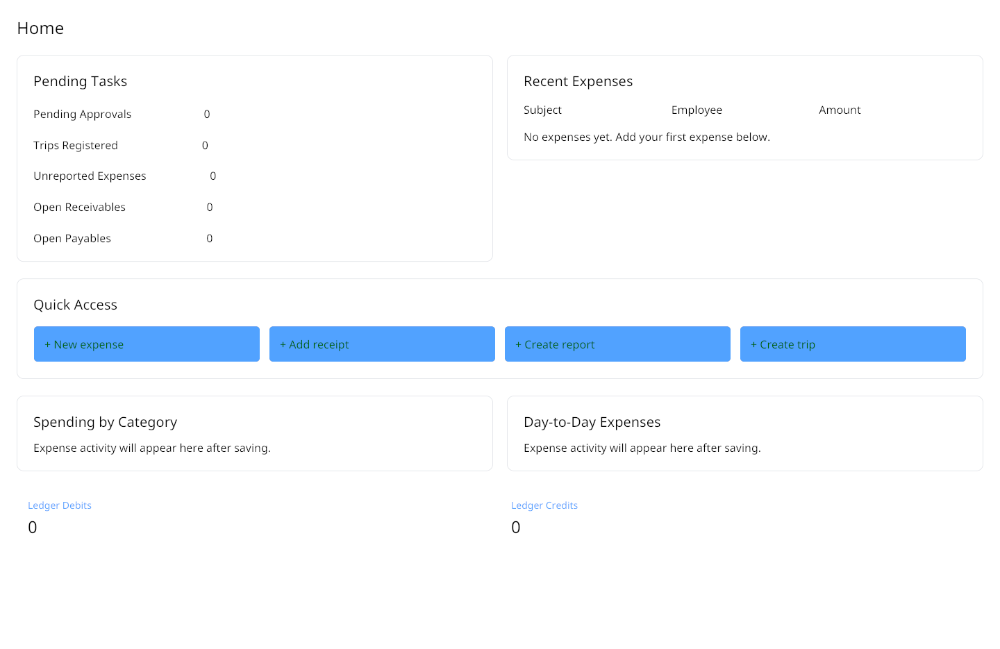
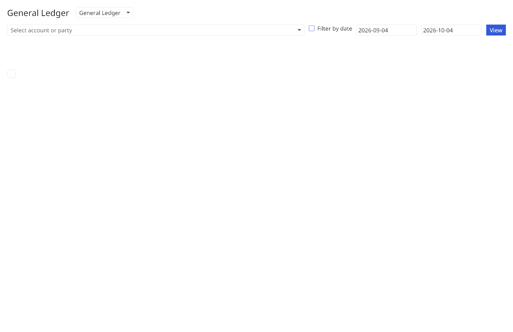
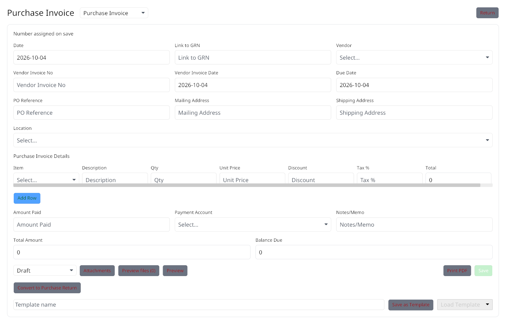
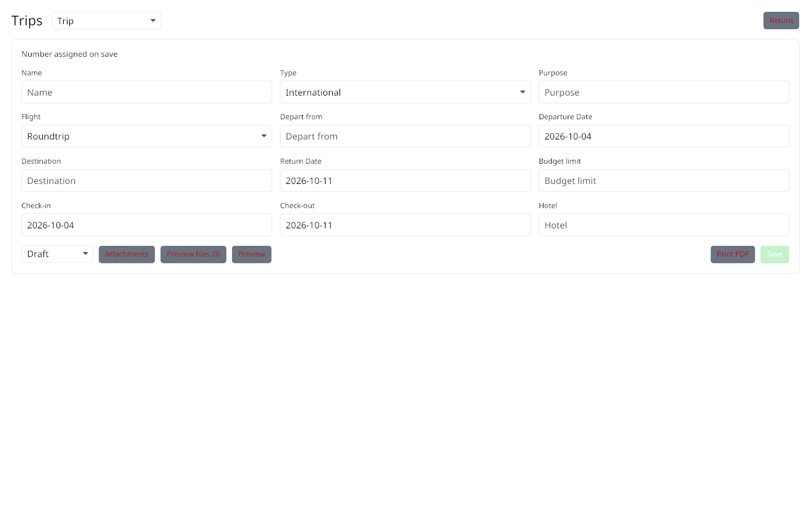
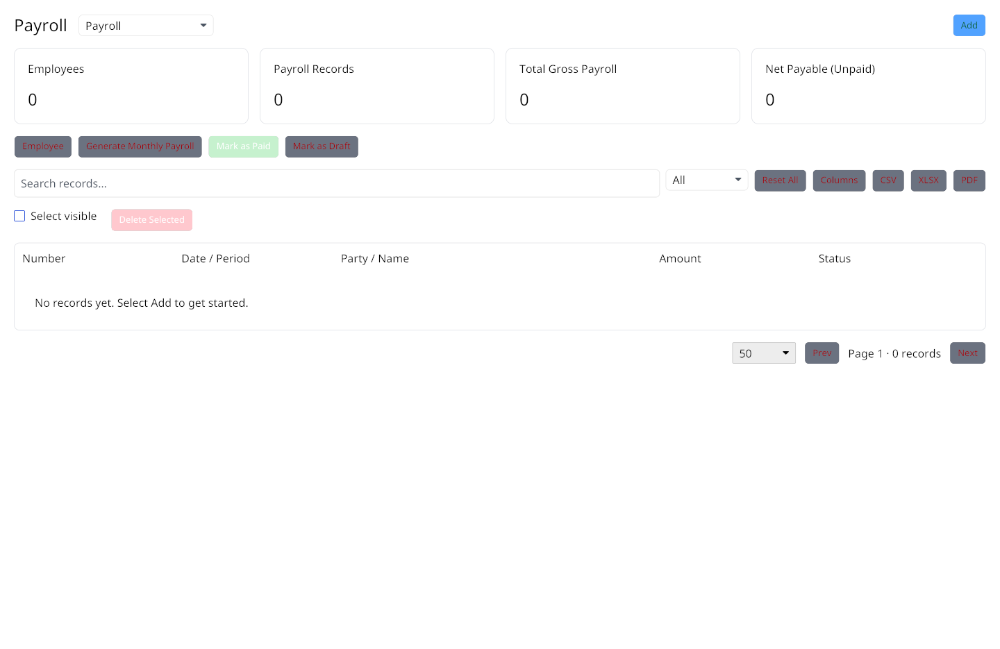
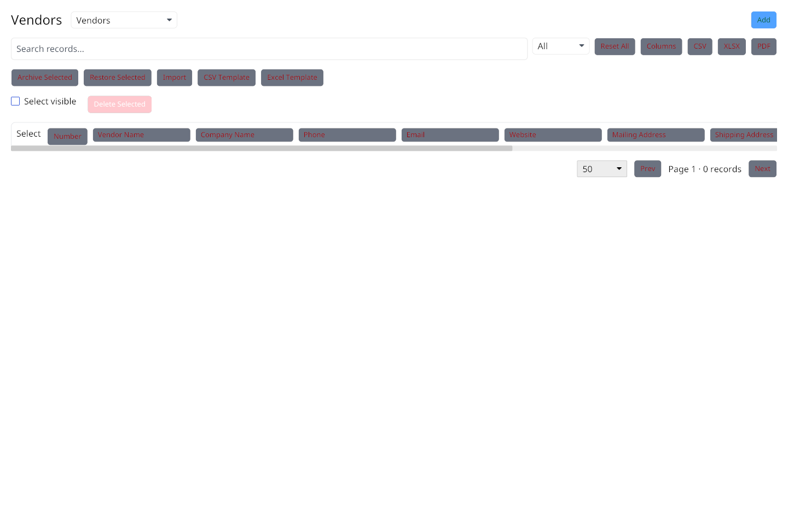
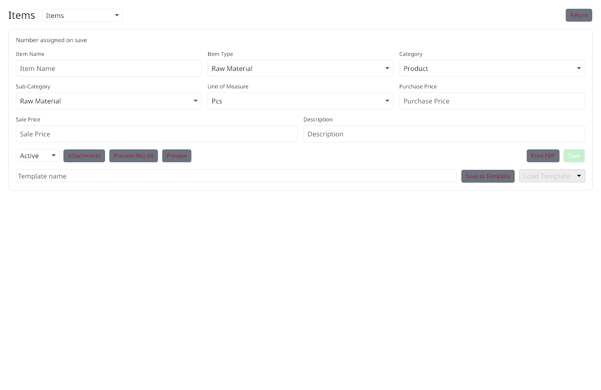

# MemonBooks native Rust implementation

This document describes the application that is implemented in this repository. `Complete_Project_User_Guide.md` was used as the source for feature and workflow behavior, while `PROJECT_SPEC.md` governs the technology and project rules. Where the guide mentions Python, PyQt6, browser pages, or JSON-backed storage, this implementation uses Rust, Iced, native desktop controls, and the existing SQLite database instead.

## What is included

- A native Iced home dashboard with book totals, recent expenses, category and daily summaries, and shortcuts into common workflows.
- A shared, schema-driven list and editor for purchase orders/invoices/returns, goods receipts, cash and bank receipts/payments, journal vouchers, quotations, sales orders/invoices/returns, delivery challans, trips, expense claims, employees, payroll, and master data.
- Master-data screens for accounts, vendors, customers, items, and inventory locations. Existing application master tables remain authoritative; additional guide-specific profile fields are retained with the company-scoped workflow record.
- Document search, status filtering, sorting, pagination, configurable columns, custom fields, templates, file attachments, import, CSV/XLSX/PDF export, and print-to-PDF.
- Decimal-based totals, line discounts/tax/withholding, document conversion, stock effects, receivable/payable posting and payment allocation, fiscal-period checks, journal balance validation, payroll calculation, and paid payroll posting.
- Native accounting views for the general ledger, trial balance, and receivable/payable party reports.

The workflow data and attachments are company-scoped in SQLite and introduced by migration `2000_native_workflows.sql`. Posting creates ledger transactions in the same database transaction as the source document and stock/subledger effects.

## Design references

All images under `docs/` and its subdirectories were reviewed. The accounting desktop references (dashboard, general ledger, vendor maintenance, payroll, purchase invoice, and timestamped application captures) informed the white/light theme, compact toolbar, card panels, searchable data grids, form sections, and spacing. The unrelated Koru/healthcare references were treated as visual references for clear navigation, grouped fields, status chips, and restrained panels rather than as accounting content. The native captures below show the current Iced implementation at 1440×935.















## Setup and running

Install a supported Rust toolchain and the native system libraries required by Iced/winit and `rfd` for the target desktop environment. Then, from the repository root:

```sh
cargo check --offline
cargo run --offline
```

Cargo downloads are needed only if the dependency cache is incomplete; use `cargo check`/`cargo run` without `--offline` where network access is available. The program opens the native desktop application. Its existing startup/authentication flow and company setup remain in place.

## Using the workflows

Use the left navigation to open Home, Documents, Accounting, Trips, Payroll, Expense Claims, or Maintain. Choose a document type from the page selector, then use Add to create a draft. Pick list values from the native dropdowns, complete required fields, add or remove line rows, and Save. Existing drafts can be searched, filtered, sorted, selected, edited, converted to a related document, exported, or printed. Posting states that affect books validate the company, account, fiscal period, and balancing rules before being committed.

Maintain exposes account, vendor, customer, item, and location records. Archive a master before permanent deletion. Item stock by location is adjusted through the item's stock fields. Payroll can be generated for active employees for a selected period; already generated employee/period pairs are skipped. Marking payroll Paid records the payment date and posts it to the ledger.

File import/export and attachment actions use native file dialogs. Attachments are copied into the configured uploads directory. Imported spreadsheets must include a name column appropriate to the selected master; CSV and XLSX are supported for master import. CSV, XLSX, and PDF exports work from selected rows; PDF also serves as the print format.

## Verification

Checks completed on 2026-10-04:

- `cargo check --offline` — passed.
- `cargo test --offline` — passed: 744 library tests and 34 integration tests (778 total), with no failures. This includes all existing accounting, banking, expenses, fixed assets, inventory, POS, purchases, reports, sales, tax, styling-consistency tests and 18 new workflow integration tests.
- `cargo build --offline --bin native_ui_check` — passed.
- Native Iced UI check — opened the actual desktop renderer using an in-memory database and captured 48 screens (dashboard, ledger, and list/form states for all 23 document and master types) at 1440×935. Selected captures are included above; the full temporary capture set was written to `/tmp/memonbooks-ui`.
- `git diff --check` — passed before the final documentation pass; it is repeated before commit.

No browser check applies to this native desktop project. The UI check verifies real Iced widget construction and rendering; it does not automate mouse/keyboard interactions or platform-specific file dialog behavior.

## Remaining work and limits

- The native screenshot harness renders page views directly rather than traversing the complete authenticated app shell, and it does not simulate user input. Manual end-to-end interaction on additional desktop platforms remains to be performed.
- Some legacy feature views remain available in the existing application alongside the new unified document workflows. The guide's advanced business claims should be evaluated against the actual workflows above rather than its Python/PyQt implementation suggestions.
- OS-specific packaging, signing, installer generation, and cross-platform accessibility verification are not included in this change.
