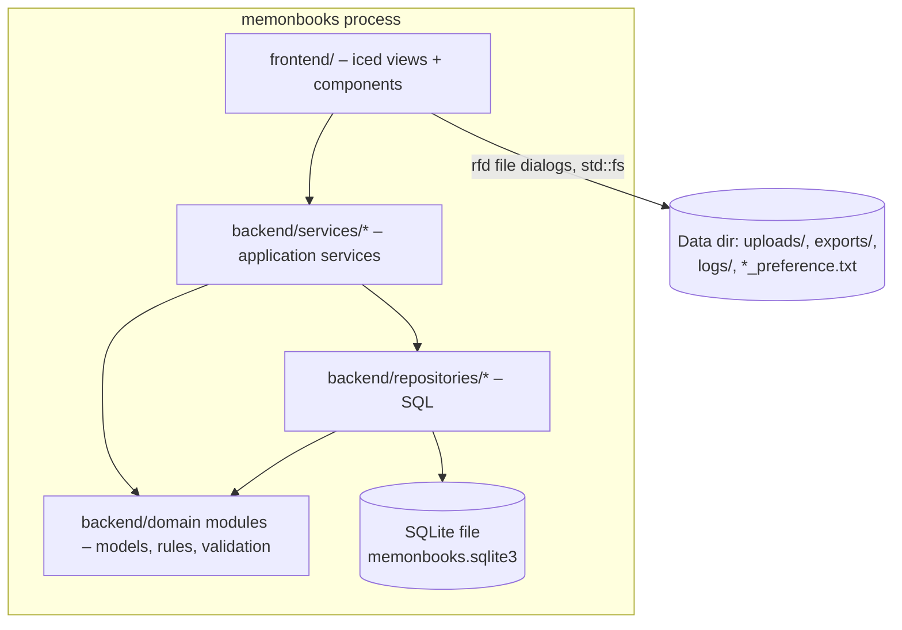
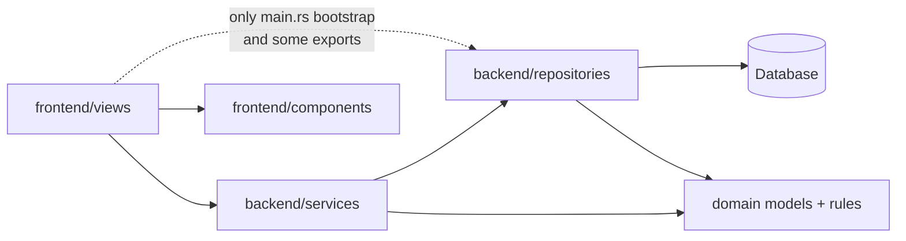
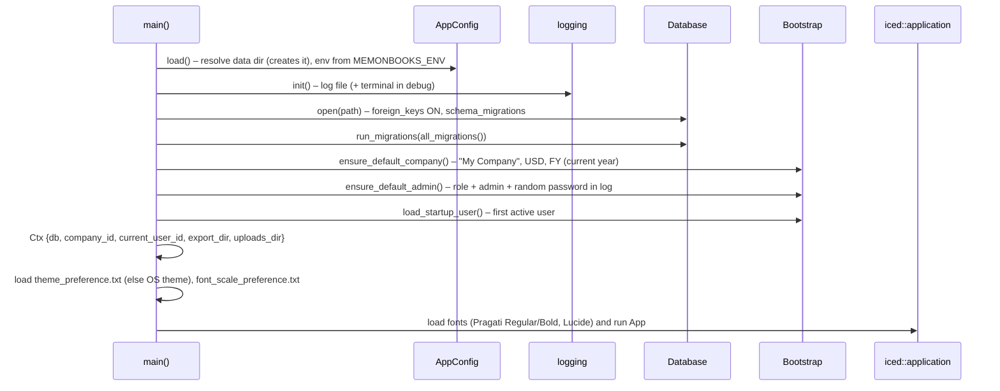
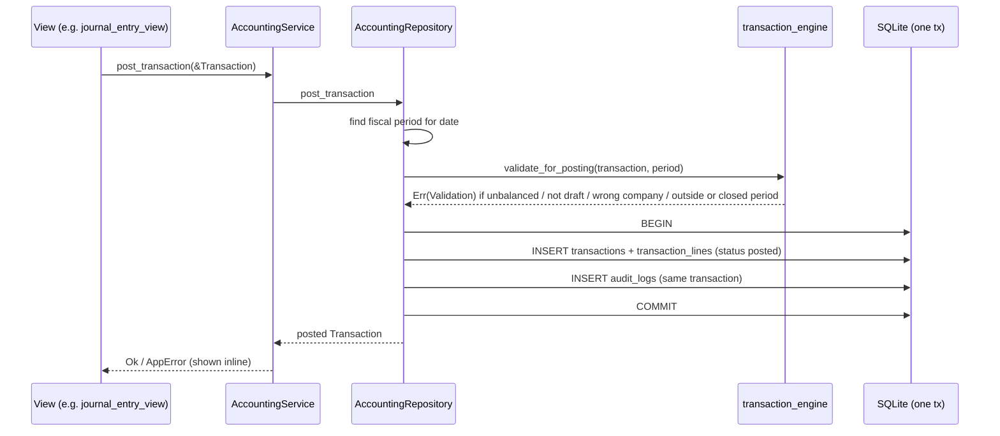
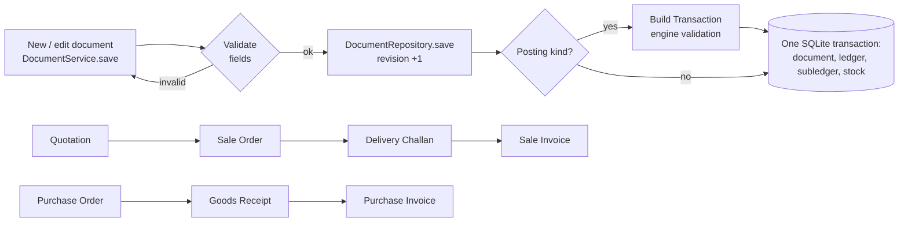
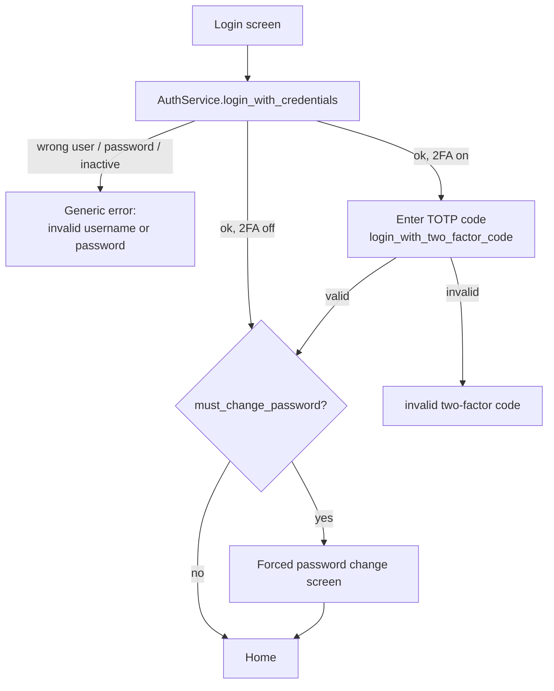
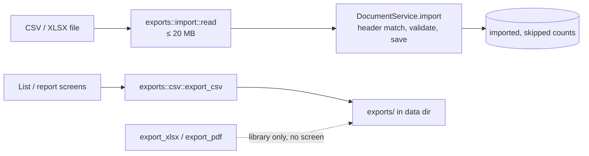

# MemonBooks – Architecture

Related documents: [README](../README.md) · [PRD](prd.md) · [Design](design.md) · [Database](database.md) · [API / service layer](api.md) · [Security](security.md) · [Implementation](project-implementation.md) · [Feature development](feature-development.md)

## Table of contents

1. [Overview](#1-overview)
2. [Technology stack](#2-technology-stack)
3. [Source layout](#3-source-layout)
4. [Layers and dependency rule](#4-layers-and-dependency-rule)
5. [Start-up sequence](#5-start-up-sequence)
6. [UI architecture (Elm style)](#6-ui-architecture-elm-style)
7. [Data flow: posting a transaction](#7-data-flow-posting-a-transaction)
8. [Workflows](#8-workflows)
9. [Module map](#9-module-map)
10. [Cross-cutting concerns](#10-cross-cutting-concerns)
11. [Binaries and packaging](#11-binaries-and-packaging)
12. [Open questions](#12-open-questions)

---

## 1. Overview

MemonBooks is a single-process, offline, native desktop application written in Rust. There is no server, no HTTP API and no network access: the UI, the business rules and the SQLite database all run inside one executable. The structure is frozen by `PROJECT_SPEC.md` (§2); the rule *"Iced View → Service → Repository → Database"* is its Architecture Rule (§3).



## 2. Technology stack

All versions are from `Cargo.toml`.

| Concern | Crate / tool |
|---------|--------------|
| Language | Rust 2021, toolchain channel `stable` (`rust-toolchain.toml`) |
| UI | `iced` 0.13 (feature `lazy`), wgpu renderer |
| Database | `rusqlite` 0.32 (`bundled`, `chrono`) |
| Money | `rust_decimal` 1, `rust_decimal_macros` 1 |
| Errors / logging | `thiserror` 2, `log` 0.4, `simplelog` 0.12 |
| Paths | `directories` 5 |
| Passwords / 2FA | `argon2` 0.5, `totp-rs` 5, `rand` 0.8 |
| Licence signing | `hmac` 0.12, `sha2` 0.10 |
| Export | `rust_xlsxwriter` 0.79, `printpdf` 0.7, `png` 0.17 |
| Import | `zip` 2.4 (deflate), `quick-xml` 0.41 (XLSX reading); CSV parser is hand-written |
| Native file dialog | `rfd` 0.15 with the `gtk3` feature (blocking `FileDialog`) |
| Theme detection | `dark-light` 1 |
| Dev | `ttf-parser` 0.25 (font tests) |

No HTTP client, no async runtime and no ORM are used. The `update` functions run blocking calls directly (no `iced::Task` chains for I/O), which is why `rfd` uses `gtk3`.

## 3. Source layout

```
MemonBooks/
├── Cargo.toml, rust-toolchain.toml, CHANGELOG.md, PROJECT_SPEC.md
├── src/
│   ├── main.rs            composition root + iced application (App, Route, Message)
│   ├── lib.rs             crate root: #[path] wiring + all_migrations()
│   ├── demo_data.rs       DEMO- tagging helpers
│   └── bin/               seed_demo_data, clear_demo_data, native_ui_check
├── backend/               business logic (no UI types)
│   ├── core/              errors, validation, roles, permissions, users, auth/, logging
│   ├── accounting/        chart of accounts, fiscal periods, GL, trial balance, closing
│   ├── transactions/      Transaction, TransactionLine, engine, documents (workflow Kind)
│   ├── services/          application services called by views
│   ├── repositories/      SQL + schema migrations
│   ├── sales/ purchases/ inventory/ banking/ expenses/ fixed_assets/ tax/ hr/
│   ├── parties/ organization/ currency/ pos/ reports/ settings/ notifications/
│   ├── audit/ backup/ warehouse_layout/
├── database/              database.rs (connection, runner), exports/ (csv, xlsx, pdf, import), migrations/
├── configs/               app.rs (paths), environment.rs, theme/font-scale preference files
├── frontend/
│   ├── components/        every style and reusable widget (see design.md)
│   ├── views/             screens: accounting, auth, dashboard, hr, inventory, pos, reports, sales, settings
│   ├── i18n/              en/ur/ar stubs (one line each)
│   └── resources/         SVG/PNG
├── assets/fonts/          Pragati Narrow (Latin), Lucide
├── packaging/             linux/flatpak, macos, windows (no business logic)
├── tests/                 integration tests per domain + style_consistency + workflows.rs
└── docs/                  this documentation, user guide, design reference images
```

The root crate is `memonbooks`. Because `backend/`, `configs/`, `database/` and `frontend/` sit outside `src/`, `src/lib.rs` includes them with `#[path = "../backend/mod.rs"]` etc.

## 4. Layers and dependency rule



| Layer | Responsibility | May depend on |
|-------|----------------|---------------|
| `frontend/components` | styles, tokens, reusable widgets; no business logic | iced, `colors`, `typography`, `spacing` |
| `frontend/views` | screen state, `Message`, `update`, `view`; calls services | components, services, domain types |
| `backend/services` | one service per area; permission checks (auth), orchestration | repositories, domain |
| `backend/repositories` | SQL, transactions, migrations for their tables | `Database`, domain |
| domain modules | models, `Validate` impls, pure rules (`transaction_engine`, `fiscal_periods`) | `core`, `rust_decimal` |

Exception recorded in `src/main.rs`: the composition root talks to repositories directly for one-time bootstrap (default company, admin user, fiscal period) because no session exists yet.

## 5. Start-up sequence



Important: `load_startup_user` is documented in code as a *temporary development startup session* – the app opens directly as the first active user and the login screen is only shown after signing out / switching user. See [security.md](security.md).

## 6. UI architecture (Elm style)

`App` in `src/main.rs` owns `Route`, the `Ctx`, the session user, theme, font scale, sidebar state and one `State` per view. Each view module exposes:

```rust
pub struct State { .. }          // screen state
pub enum Message { .. }          // user intents
pub fn update(state: &mut State, message: Message, ctx: &Ctx)   // may call services
pub fn view(state: &State, theme: Theme) -> Element<'_, Message>
```

`App::update` maps wrapper messages (for example `Message::Login(login_view::Message)`) to the view's `update`; `App::view` renders the login screen when there is no session, the forced password-change screen when `must_change_password` is set, otherwise sidebar + the active route. Routes are listed in `NAV_ITEMS`: Home, Accounting, Maintain, New Journal Entry, Journal Entries, Trial Balance, Fixed Assets, Tax Rates, Ledger Invoices / Bills, Products, Employees, Expenses, Point of Sale, Reports, Settings, Companies, Switch User, Users.

Process-global UI state is limited to the font scale and window width (atomics in `font_scale.rs`) so size getters need no context.

## 7. Data flow: posting a transaction



`Transaction::is_balanced` compares `total_debits()` with `total_credits()` as `Decimal`. A posted transaction is immutable; `reverse_transaction` builds a mirror transaction (`Transaction::build_reversal`) and links both rows.

## 8. Workflows

### 8.1 Document lifecycle (native workflows)

The 23 `Kind`s in `backend/transactions/documents.rs` share one schema-driven model and storage (`workflow_*` tables, [database.md](database.md#611-native-document-workflows-2000)) behind `DocumentService`/`DocumentRepository`. **Status: backend Implemented and tested (`tests/workflows.rs`); no generic editor screen exists in the current `frontend/views/`** – the only view that calls `DocumentService` is the dashboard (read-only summary). The Maintain screen uses the typed party/banking/warehouse/accounting services instead. Master kinds (Account, Vendor, Item, Customer, Location) can be imported from CSV/XLSX through `DocumentService::import`, but no view calls it yet.



"Document, ledger, subledger and stock changes commit together" is the stated contract of `document_repository.rs`.

### 8.2 Login



### 8.3 Import / export (CSV export has screens; import, XLSX and PDF are library code only)



## 9. Module map

| Area | Domain module(s) | Service | Repository | View(s) |
|------|------------------|---------|------------|---------|
| Chart of accounts, journal, GL, TB | `accounting/`, `transactions/` | `accounting_service` | `accounting_repository` | `maintain/chart_of_accounts_view`, `journal_entry(ies)_view`, `ledger_view`, `trial_balance_view` |
| Parties | `parties/` | `party_service` (+ `purchase_service` / `sales_service` for ledgers) | `party_repository` | `maintain/vendors_view`, `maintain/customers_view` |
| Maintain hub | – | – | – | `maintain/maintain_view` switches between Chart of Accounts, Customers, Vendors, Bank Accounts, Warehouses |
| Banking | `banking/` | `banking_service` | `banking_repository` | `maintain/bank_of_accounts_view` |
| Inventory & warehouses | `inventory/`, `warehouse_layout/` | `inventory_service`, `warehouse_layout/service` | `inventory_repository`, `warehouse_layout/repository` | `inventory/products_view`, `maintain/warehouse_view` |
| Sales / POS | `sales/`, `pos/` | `sales_service` | `sales_repository` | `sales/invoices_view`, `pos/pos_view` |
| Purchases | `purchases/` | `purchase_service` | `purchase_repository` | `inventory/bills_view` |
| Document workflows | `transactions/documents` | `document_service` | `document_repository` | `dashboard_view` (read-only) |
| Expenses | `expenses/` | `expense_service` | `expense_repository` | `hr/expenses_view` |
| Fixed assets | `fixed_assets/` | `fixed_asset_service` | `fixed_asset_repository` | `accounting/fixed_assets_view` |
| Tax | `tax/` | `tax_service` | `tax_repository` | `accounting/tax_rates_view` |
| HR / payroll | `hr/` | `organization_service`, `document_service.generate_payroll` | `organization_repository` | `hr/employees_view` |
| Organisation | `organization/` | `organization_service` | `organization_repository` | `settings/companies_view` |
| Users / auth | `core/` | `auth_service` | `user_repository` | `auth/*`, `settings/users_view` |
| Reports | `reports/` | `report_service` | (reads via accounting/party repos) | `reports/reports_view`, `dashboard_view` |
| Backup | `backup/` | – | – | none yet |

Empty or stub modules (single comment line or `// TODO`): `services/api.rs`, `services/commands.rs`, `services/transaction_service.rs`, `core/telemetry.rs`, `audit/activity_logs.rs`, `audit/change_history.rs`, all of `backend/settings/*` except `mod.rs`, `frontend/i18n/*`, and the `frontend/components` stubs `modal`, `dialogs`, `confirmation`.

## 10. Cross-cutting concerns

| Concern | Implementation |
|---------|----------------|
| Errors | `AppError` (`Database`, `Migration`, `Io`, `Config`, `Validation`, `NotFound`, `Internal`) via `thiserror`; `AppResult<T>` everywhere; views show `error`/`message` strings inline |
| Validation | `Validate` trait + helpers in `core/validation.rs` (`require_non_empty`, `require_max_length`, `require_non_negative`, `require_positive`) |
| Logging | `simplelog`: file `<data>/logs/memonbooks.log`; Debug level in development/test, Info in production; terminal logger added when the level is Debug |
| Environment | `MEMONBOOKS_ENV` = `production`/`prod`, `test`, `development`/`dev`; default is development for debug builds, production for release |
| Audit | `audit_logs` row written inside the posting transaction (`audit::audit_logs::record`) |
| Money | `rust_decimal::Decimal` only |
| Multi-company | `company_id` on all business tables; `Ctx.company_id` |

## 11. Binaries and packaging

| Binary | Source | Purpose |
|--------|--------|---------|
| `memonbooks` | `src/main.rs` | the application |
| `seed_demo_data` | `src/bin/seed_demo_data.rs` | fill the configured DB with `DEMO-` data through the services |
| `clear_demo_data` | `src/bin/clear_demo_data.rs` | remove it |
| `native_ui_check` | `src/bin/native_ui_check.rs` | render real widgets against an in-memory DB for visual checks; never opens a user's DB |

Packaging manifests: `packaging/linux/flatpak/` (manifest, `.desktop`, metainfo), `packaging/macos/` (Info.plist, entitlements, icns), `packaging/windows/` (AppxManifest, assets, ico). The Flatpak manifest itself says it has not been built in the author's environment.

## 12. Open questions

1. `src/main.rs` bypasses login at start-up (`load_startup_user`). Is this to be removed before release?
2. Which of the typed modules (`sales/invoices`, `purchases/bills`, …, migrations 1000/1001) and which of the `workflow_*` documents is the long-term source of truth for invoices and bills?
3. Several domain modules (notifications, settings, currency conversions, attendance/leave) have models but no service or view; keep or remove?
4. The services layer is explicit about permission checks only in `auth_service`; should other services check permissions?
5. Should `services/api.rs` / `commands.rs` be deleted, since no API is planned?
6. macOS and Windows builds are targets in `PROJECT_SPEC.md`, but only Linux was verified for this documentation.
