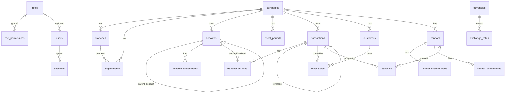
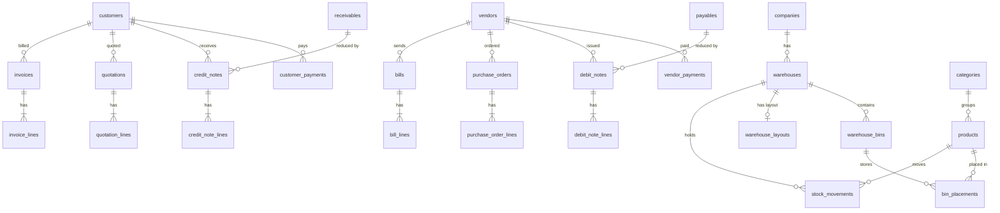
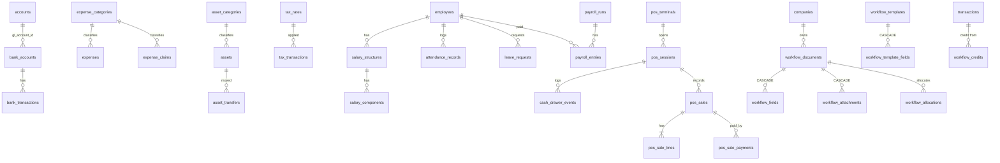

# MemonBooks – Database

MemonBooks stores everything in a single embedded **SQLite** file, accessed through `rusqlite` 0.32 (bundled SQLite, so no system SQLite is needed). Everything in this document is derived from the migration code; the authoritative sources are listed per table.

Related documents: [README](../README.md) · [Architecture](architecture.md) · [API / service layer](api.md) · [Security](security.md) · [Implementation](project-implementation.md)

## Table of contents

1. [Location, connection and settings](#1-location-connection-and-settings)
2. [Conventions](#2-conventions)
3. [Migration mechanism](#3-migration-mechanism)
4. [Migration list](#4-migration-list)
5. [ER diagrams](#5-er-diagrams)
6. [Tables](#6-tables)
7. [Indexes and constraints summary](#7-indexes-and-constraints-summary)
8. [Backup and restore](#8-backup-and-restore)
9. [Open questions](#9-open-questions)

---

## 1. Location, connection and settings

| Item | Value |
|------|-------|
| File name | `memonbooks.sqlite3` |
| Folder | Per-user data directory from the `directories` crate with qualifier `com`, organisation `MemonBooks`, application `MemonBooks` (`configs/app.rs`) |
| Linux | `~/.local/share/memonbooks/memonbooks.sqlite3` (honours `XDG_DATA_HOME`) |
| Windows | `%APPDATA%\MemonBooks\MemonBooks\data\memonbooks.sqlite3` |
| macOS | `~/Library/Application Support/com.MemonBooks.MemonBooks/memonbooks.sqlite3` |
| Log | `<data dir>/logs/memonbooks.log` |
| Other files in the data dir | `exports/` (CSV/XLSX/PDF output), `uploads/` (attachments), `theme_preference.txt`, `font_scale_preference.txt` |
| Flatpak | the sandbox's private `XDG_DATA_HOME` (`packaging/linux/flatpak/*.yml`) |
| Tests | `Database::open_in_memory()` – an ephemeral in-memory database |

The Linux and macOS paths come from the `directories` crate documentation and the comment in `configs/app.rs`; the exact Windows sub-folder (`...\data`) is the `directories` 5 behaviour and was **not** verified on a Windows machine. The running application writes the resolved database path to its log at start-up (`database path: ...`).

Connection handling (`database/database.rs`): one `rusqlite::Connection` shared as `Arc<Mutex<Connection>>`; `PRAGMA foreign_keys = ON` is set on open. No WAL mode, busy timeout or other pragma is set.

## 2. Conventions

| Topic | Convention |
|-------|------------|
| Primary keys | `id INTEGER PRIMARY KEY AUTOINCREMENT` (except `currencies.code`, `warehouse_layouts.warehouse_id`, and the `workflow_*` tables, which use plain `INTEGER PRIMARY KEY` or composite keys) |
| Money and quantities | **`TEXT`** holding a `rust_decimal::Decimal` string (e.g. `'0'`); never `REAL`. Examples: `debit`, `credit`, `amount`, `quantity`, `unit_price`, `cost_price` |
| Dates | `TEXT` ISO-8601 (`YYYY-MM-DD`) for business dates; `strftime('%Y-%m-%dT%H:%M:%fZ','now')` default for audit timestamps; `accounts.create_timestamp`/`modified_timestamp` are `INTEGER` |
| Booleans | `INTEGER` 0/1 (`is_active`, `is_deduction`, `is_disposed`, …) |
| Multi-company | Almost every business table has `company_id REFERENCES companies(id)` |
| Deletion | No `ON DELETE CASCADE` except the `workflow_*` child tables; repositories turn foreign-key violations into friendly errors (`AppError::is_constraint_violation`) |
| Ledger posting | Posted ledger rows are immutable; corrections are reversing transactions (`reverses_transaction_id` / `reversed_by_transaction_id`) |

## 3. Migration mechanism

* Migrations are Rust `Migration { version, name, sql }` constants (`pub const MIGRATIONS`) in the repository module that owns the tables. Only the `workflow_*` migration lives in a real `.sql` file (`database/migrations/2000_native_workflows.sql`, embedded with `include_str!`).
* `memonbooks::all_migrations()` (`src/lib.rs`) collects every list; `Database::run_migrations` sorts by version, rejects duplicate versions, skips migrations already recorded in `schema_migrations` (matching by version **and** name), and runs each in its own transaction, recording the version only on success.
* Version numbers are one global namespace. Already-shipped SQL is never edited; changes are added as new `ALTER TABLE` migrations.
* The same list is used by `src/main.rs`, `seed_demo_data` and `clear_demo_data`.

`schema_migrations`: `version INTEGER PRIMARY KEY`, `name TEXT NOT NULL`, `applied_at TEXT NOT NULL DEFAULT (strftime('%Y-%m-%dT%H:%M:%fZ','now'))`.

## 4. Migration list

29 migrations, in application order.

| Version | Name | Defined in | Effect |
|--------:|------|------------|--------|
| 300 | `organization_and_currency_schema` | `organization_repository.rs` | `companies`, `branches`, `departments`, `currencies`, `exchange_rates` |
| 400 | `users_roles_sessions_schema` | `user_repository.rs` | `roles`, `role_permissions`, `users`, `sessions` |
| 401 | `audit_logs_schema` | `backend/audit/audit_logs.rs` | `audit_logs` |
| 402 | `users_must_change_password` | `user_repository.rs` | `users.must_change_password` |
| 403 | `users_is_reset_requested` | `user_repository.rs` | `users.is_reset_requested` |
| 500 | `chart_of_accounts_and_fiscal_periods_schema` | `accounting_repository.rs` | `accounts`, `fiscal_periods` |
| 501 | `accounts_reference_code_column` | `accounting_repository.rs` | `accounts.reference_code` + partial unique index |
| 502 | `accounts_chart_of_accounts_fields` | `accounting_repository.rs` | renames `code`→`account_code`, `name`→`account_name`, `parent_id`→`parent_account`; `is_active` → `status`; adds `description`, `create_timestamp`, `modified_timestamp`; `account_attachments` |
| 600 | `transactions_and_transaction_lines_schema` | `accounting_repository.rs` | `transactions`, `transaction_lines` |
| 900 | `parties_schema` | `party_repository.rs` | `customers`, `vendors`, `addresses`, `contacts` |
| 901 | `receivables_and_payables_schema` | `accounting_repository.rs` | `receivables`, `payables` |
| 902 | `customers_and_vendors_reference_code_columns` | `party_repository.rs` | `reference_code` on both + partial unique indexes |
| 903 | `vendor_type_column` | `party_repository.rs` | `vendors.vendor_type` (default `'Other'`) |
| 904 | `vendor_company_name_column` | `party_repository.rs` | `vendors.company_name` |
| **905** | `vendor_profile_fields_custom_fields_and_attachments` | `party_repository.rs` | `vendors.website`, `mailing_address`, `shipping_address`, `payment_method`, `description` (all nullable); new `vendor_custom_fields`, `vendor_attachments` |
| 1000 | `sales_schema` | `sales_repository.rs` | `quotations`(+`_lines`), `invoices`(+`_lines`), `credit_notes`(+`_lines`), `customer_payments` |
| 1001 | `purchases_schema` | `purchase_repository.rs` | `purchase_orders`(+`_lines`), `bills`(+`_lines`), `debit_notes`(+`_lines`), `vendor_payments` |
| 1100 | `inventory_schema` | `inventory_repository.rs` | `warehouses`, `categories`, `products`, `stock_movements` |
| 1200 | `banking_schema` | `banking_repository.rs` | `bank_accounts`, `bank_transactions` |
| **1201** | `bank_accounts_profile_fields` | `banking_repository.rs` | `bank_accounts.parent_company`, `sub_company` (`''`), `account_type` (`'Debit'`), `opening_balance` (`'0'`) |
| 1300 | `expenses_schema` | `expense_repository.rs` | `expense_categories`, `expenses`, `expense_claims` |
| 1301 | `fixed_assets_schema` | `fixed_asset_repository.rs` | `asset_categories`, `assets`, `asset_transfers` |
| 1400 | `tax_schema` | `tax_repository.rs` | `tax_rates`, `tax_transactions` |
| 1401 | `tax_rates_reference_code_column` | `tax_repository.rs` | `tax_rates.reference_code` + partial unique index |
| 1600 | `products_barcode_column` | `inventory_repository.rs` | `products.barcode` |
| 1601 | `pos_schema` | `sales_repository.rs` | `pos_terminals`, `pos_sessions`, `cash_drawer_events`, `pos_sales`, `pos_sale_lines`, `pos_sale_payments` |
| 1700 | `hr_and_payroll_schema` | `organization_repository.rs` | `employees`, `salary_structures`, `salary_components`, `attendance_records`, `leave_requests`, `payroll_runs`, `payroll_entries` |
| **1810** | `warehouse_layout_schema` | `backend/warehouse_layout/repository.rs` | `warehouse_layouts`, `warehouse_bins`, `bin_placements` |
| 2000 | `native_document_workflows` | `document_repository.rs` + `database/migrations/2000_native_workflows.sql` | `workflow_documents`, `workflow_fields`, `workflow_attachments`, `workflow_templates`, `workflow_template_fields`, `workflow_credits`, `workflow_allocations`, index `workflow_company_kind` |

Version 1 is also used by two tests inside `backend/backup/*` against throw-away databases; it is not part of the shipped schema.

## 5. ER diagrams

### 5.1 Core: organisation, users, ledger, parties

### 5.2 Sales, purchases, inventory, warehouse layout

### 5.3 Banking, expenses, assets, tax, HR, POS, workflow documents

## 6. Tables

`PK` primary key, `FK` foreign key. "NN" = `NOT NULL`. Money columns are TEXT (see conventions).

### 6.1 Organisation and currency (300)

| Table | Columns |
|-------|---------|
| `companies` | `id` PK, `name` NN, `legal_name`, `base_currency_code` NN, `created_at` NN default now |
| `branches` | `id` PK, `company_id` FK NN, `name` NN, `code` NN, `address`, `created_at`; **UNIQUE** (`company_id`,`code`) |
| `departments` | `id` PK, `company_id` FK NN, `branch_id` FK, `name` NN, `code` NN, `created_at`; **UNIQUE** (`company_id`,`code`) |
| `currencies` | `code` PK, `name` NN, `symbol` NN, `decimal_places` INTEGER NN |
| `exchange_rates` | `id` PK, `from_currency` FK NN, `to_currency` FK NN, `rate` TEXT NN, `as_of` NN; **UNIQUE** (`from_currency`,`to_currency`,`as_of`) |

### 6.2 Users and audit (400–403)

| Table | Columns |
|-------|---------|
| `roles` | `id` PK, `name` NN **UNIQUE**, `description` |
| `role_permissions` | `role_id` FK NN, `permission_key` NN; PK (`role_id`,`permission_key`) |
| `users` | `id` PK, `username` NN **UNIQUE**, `display_name` NN, `password_hash` NN, `role_id` FK NN, `is_active` default 1, `two_factor_enabled` default 0, `two_factor_secret`, `created_at`, `must_change_password` default 0 (402), `is_reset_requested` default 0 (403) |
| `sessions` | `id` PK, `user_id` FK NN, `token` NN **UNIQUE**, `created_at` NN, `expires_at` NN, `revoked_at` |
| `audit_logs` | `id` PK, `user_id`, `action` NN, `entity_type`, `entity_id`, `detail`, `occurred_at` NN default now |

### 6.3 Accounting (500–600, 901)

| Table | Columns |
|-------|---------|
| `accounts` | `id` PK, `company_id` FK NN, `account_code` NN, `account_name` NN, `account_type` NN, `parent_account` FK→`accounts`, `status` NN default `'Active'`, `reference_code`, `description` NN default `''`, `create_timestamp` INTEGER NN, `modified_timestamp` INTEGER NN; **UNIQUE** (`company_id`,`account_code`); unique index on `reference_code` where not null |
| `account_attachments` | `id` PK, `account_id` FK NN, `file_name` NN |
| `fiscal_periods` | `id` PK, `company_id` FK NN, `name` NN, `start_date` NN, `end_date` NN, `status` NN |
| `transactions` | `id` PK, `company_id` FK NN, `transaction_type` NN, `transaction_date` NN, `description`, `status` NN, `reverses_transaction_id` FK, `reversed_by_transaction_id` FK, `posted_by_user_id`, `posted_at` NN default now |
| `transaction_lines` | `id` PK, `transaction_id` FK NN, `account_id` FK NN, `debit` TEXT NN, `credit` TEXT NN, `description`, `line_number` NN |
| `receivables` | `id` PK, `company_id` FK NN, `customer_id` FK NN, `reference`, `invoice_date` NN, `due_date` NN, `amount` NN, `amount_paid` NN default `'0'`, `transaction_id` FK |
| `payables` | `id` PK, `company_id` FK NN, `vendor_id` FK NN, `reference`, `bill_date` NN, `due_date` NN, `amount` NN, `amount_paid` NN default `'0'`, `transaction_id` FK |

The invariant *total debits = total credits* is enforced in the transaction engine (`backend/transactions/transaction_engine.rs`) before insert, not by a SQL constraint.

### 6.4 Parties (900, 902–905)

| Table | Columns |
|-------|---------|
| `customers` | `id` PK, `company_id` FK NN, `name` NN, `email`, `phone`, `tax_id`, `credit_limit` TEXT NN, `payment_terms_days` NN, `is_active` default 1, `reference_code` (unique where not null) |
| `vendors` | `id` PK, `company_id` FK NN, `name` NN, `email`, `phone`, `tax_id`, `payment_terms_days` NN, `is_active` default 1, `reference_code` (unique where not null), `vendor_type` NN default `'Other'`, `company_name`, and from **905**: `website`, `mailing_address`, `shipping_address`, `payment_method`, `description` |
| `vendor_custom_fields` (905) | `id` PK, `vendor_id` FK NN, `name` NN, `value` NN |
| `vendor_attachments` (905) | `id` PK, `vendor_id` FK NN, `file_name` NN (name on disk in `uploads/`), `display_name` NN (original name), `size_bytes` INTEGER NN default 0 |
| `addresses` | `id` PK, `party_type` NN, `party_id` NN, `label` NN, `line1` NN, `line2`, `city` NN, `state`, `postal_code`, `country` NN (polymorphic; no FK) |
| `contacts` | `id` PK, `party_type` NN, `party_id` NN, `name` NN, `email`, `phone`, `is_primary` default 0 (polymorphic; no FK) |

### 6.5 Sales (1000) and POS (1601)

| Table | Columns |
|-------|---------|
| `quotations` | `id`, `company_id`, `customer_id`, `quotation_date`, `valid_until`, `status` |
| `quotation_lines` | `id`, `quotation_id`, `description`, `quantity`, `unit_price`, `line_number` |
| `invoices` | `id`, `company_id`, `customer_id`, `invoice_date`, `due_date`, `status`, `transaction_id` FK |
| `invoice_lines` | `id`, `invoice_id`, `revenue_account_id` FK, `description`, `quantity`, `unit_price`, `line_number` |
| `credit_notes` | `id`, `company_id`, `customer_id`, `receivable_id` FK, `credit_note_date`, `transaction_id` FK |
| `credit_note_lines` | `id`, `credit_note_id`, `revenue_account_id` FK, `description`, `amount`, `line_number` |
| `customer_payments` | `id`, `company_id`, `customer_id`, `payment_date`, `amount`, `transaction_id` FK |
| `pos_terminals` | `id`, `company_id`, `branch_id` FK, `warehouse_id` FK NN, `name`, `is_active` |
| `pos_sessions` | `id`, `terminal_id` FK, `cashier_user_id` FK, `opened_at`, `closed_at`, `opening_cash`, `closing_cash`, `status` |
| `cash_drawer_events` | `id`, `session_id` FK, `event_type`, `amount`, `reason`, `occurred_at` |
| `pos_sales` | `id`, `company_id`, `terminal_id`, `session_id`, `sale_date`, `transaction_id` FK |
| `pos_sale_lines` | `id`, `pos_sale_id`, `product_id` FK, `revenue_account_id` FK, `description`, `quantity`, `unit_price`, `line_number` |
| `pos_sale_payments` | `id`, `pos_sale_id`, `method`, `amount` |

All of the above are `NOT NULL` except `branch_id`, `closed_at`, `closing_cash`, `reason`, `transaction_id`, `receivable_id`.

### 6.6 Purchases (1001)

| Table | Columns |
|-------|---------|
| `purchase_orders` | `id`, `company_id`, `vendor_id`, `order_date`, `expected_date`, `status` |
| `purchase_order_lines` | `id`, `purchase_order_id`, `description`, `quantity`, `unit_price`, `line_number` |
| `bills` | `id`, `company_id`, `vendor_id`, `bill_date`, `due_date`, `status`, `transaction_id` FK |
| `bill_lines` | `id`, `bill_id`, `account_id` FK, `description`, `quantity`, `unit_price`, `line_number` |
| `debit_notes` | `id`, `company_id`, `vendor_id`, `payable_id` FK, `debit_note_date`, `transaction_id` FK |
| `debit_note_lines` | `id`, `debit_note_id`, `account_id` FK, `description`, `amount`, `line_number` |
| `vendor_payments` | `id`, `company_id`, `vendor_id`, `payment_date`, `amount`, `transaction_id` FK |

### 6.7 Inventory (1100, 1600) and warehouse layout (1810)

| Table | Columns |
|-------|---------|
| `warehouses` | `id` PK, `company_id` FK NN, `name` NN, `code` NN, `address`, `is_active` default 1; **UNIQUE** (`company_id`,`code`) |
| `categories` | `id` PK, `company_id` FK NN, `name` NN, `parent_id` FK→`categories` |
| `products` | `id` PK, `company_id` FK NN, `sku` NN, `name` NN, `category_id` FK, `unit_of_measure` NN, `cost_price` NN, `sale_price` NN, `track_inventory` default 1, `is_active` default 1, `barcode` (1600); **UNIQUE** (`company_id`,`sku`) |
| `stock_movements` | `id` PK, `company_id` FK NN, `product_id` FK NN, `warehouse_id` FK NN, `movement_date` NN, `movement_type` NN, `quantity_delta` TEXT NN (signed), `reference`, `transaction_id` FK |
| `warehouse_layouts` (1810) | `warehouse_id` PK FK→`warehouses`, `lines` INTEGER NN, `positions` INTEGER NN, `default_capacity` TEXT |
| `warehouse_bins` (1810) | `id` PK, `warehouse_id` FK NN, `line` NN, `position` NN, `label` NN, `capacity` TEXT; **UNIQUE** (`warehouse_id`,`line`,`position`) |
| `bin_placements` (1810) | `id` PK, `bin_id` FK NN, `product_id` FK NN, `quantity` TEXT NN; **UNIQUE** (`bin_id`,`product_id`) |

Existing warehouses simply have no layout until one is saved (1810 adds tables only).

### 6.8 Banking (1200, 1201)

| Table | Columns |
|-------|---------|
| `bank_accounts` | `id` PK, `company_id` FK NN, `gl_account_id` FK→`accounts` NN, `bank_name` NN, `account_number` NN, `currency_code` NN, `is_active` default 1, and from **1201**: `parent_company` NN `''`, `sub_company` NN `''`, `account_type` NN `'Debit'`, `opening_balance` TEXT NN `'0'` |
| `bank_transactions` | `id` PK, `company_id` FK NN, `bank_account_id` FK NN, `transaction_date` NN, `description` NN, `amount` NN, `matched_transaction_id` FK→`transactions` |

Account numbers are unique per company **by repository check, not by a UNIQUE index** (so a database that already holds a duplicate still migrates).

### 6.9 Expenses (1300), fixed assets (1301), tax (1400, 1401)

| Table | Columns |
|-------|---------|
| `expense_categories` | `id`, `company_id`, `name`, `gl_account_id` FK |
| `expenses` | `id`, `company_id`, `category_id` FK, `expense_date`, `amount`, `description`, `payment_account_id` FK, `transaction_id` FK |
| `expense_claims` | `id`, `company_id`, `claimant_name`, `category_id` FK, `claim_date`, `amount`, `description`, `status`, `transaction_id` FK |
| `asset_categories` | `id`, `company_id`, `name`, `asset_gl_account_id`, `accumulated_depreciation_gl_account_id`, `depreciation_expense_gl_account_id` (all FK→`accounts`), `default_useful_life_years`, `default_method`, `default_method_rate` |
| `assets` | `id`, `company_id`, `category_id` FK, `name`, `acquisition_date`, `acquisition_cost`, `salvage_value`, `useful_life_years`, `method`, `method_rate`, `accumulated_depreciation` default `'0'`, `is_disposed` default 0, `transaction_id` FK |
| `asset_transfers` | `id`, `asset_id` FK, `transfer_date`, `from_branch_id` FK, `to_branch_id` FK, `notes` |
| `tax_rates` | `id` PK, `company_id`, `name`, `rate_percent` TEXT, `direction`, `gl_account_id` FK, `is_active`, `reference_code` (unique where not null) |
| `tax_transactions` | `id`, `company_id`, `tax_rate_id` FK, `source_reference`, `tax_date`, `taxable_amount`, `tax_amount`, `direction`, `transaction_id` FK |

### 6.10 HR and payroll (1700)

| Table | Columns |
|-------|---------|
| `employees` | `id` PK, `company_id`, `branch_id`, `department_id`, `user_id` (FKs, last three nullable), `employee_code` NN, `full_name` NN, `email`, `phone`, `hire_date` NN, `termination_date`, `is_active`; **UNIQUE** (`company_id`,`employee_code`) |
| `salary_structures` | `id`, `employee_id` FK, `effective_date` |
| `salary_components` | `id`, `salary_structure_id` FK, `name`, `amount`, `is_deduction` |
| `attendance_records` | `id`, `employee_id` FK, `date`, `status`, `hours_worked`; **UNIQUE** (`employee_id`,`date`) |
| `leave_requests` | `id`, `employee_id` FK, `leave_type`, `start_date`, `end_date`, `status` |
| `payroll_runs` | `id`, `company_id`, `pay_period_start`, `pay_period_end`, `payment_date`, `transaction_id` FK |
| `payroll_entries` | `id`, `payroll_run_id` FK, `employee_id` FK, `gross_pay`, `total_deductions` |

### 6.11 Native document workflows (2000)

Stores the 23 document kinds of `backend/transactions/documents.rs::Kind` (Purchase Order, Purchase Invoice, Purchase Return, Goods Receipt, Cash/Bank Receipt, Cash/Bank Payment, Journal Voucher, Quotation, Sale Order, Delivery Challan, Sale Invoice, Sale Return, Trip, Expense, Employee, Payroll, and the master kinds Vendor, Customer, Item, Location, Account) as generic rows with key/value fields.

| Table | Columns |
|-------|---------|
| `workflow_documents` | `id` PK, `company_id` FK NN, `kind` NN, `number`, `status` NN, `transaction_id` FK, `revision` NN default 0, `created_at`, `modified_at`; **UNIQUE** (`company_id`,`number`); index `workflow_company_kind` (`company_id`,`kind`) |
| `workflow_fields` | `document_id` FK NN (CASCADE), `row_no` NN, `name` NN, `value` NN; PK (`document_id`,`row_no`,`name`) |
| `workflow_attachments` | `id` PK, `document_id` FK NN (CASCADE), `path` NN |
| `workflow_templates` | `id` PK, `company_id` FK NN, `kind` NN, `name` NN; **UNIQUE** (`company_id`,`kind`,`name`) |
| `workflow_template_fields` | `template_id` FK NN (CASCADE), `row_no`, `name`, `value`; PK (`template_id`,`row_no`,`name`) |
| `workflow_credits` | `id` PK, `company_id` FK NN, `party_type` NN, `party_id` NN, `transaction_id` FK NN, `amount` NN |
| `workflow_allocations` | `document_id` FK, `subledger` NN, `entry_id` NN, `amount` NN |

## 7. Indexes and constraints summary

| Index / constraint | Table(s) |
|--------------------|----------|
| `accounts_reference_code_unique` (partial, `WHERE reference_code IS NOT NULL`) | `accounts` |
| `customers_reference_code_unique`, `vendors_reference_code_unique` (partial) | `customers`, `vendors` |
| `tax_rates_reference_code_unique` (partial) | `tax_rates` |
| `workflow_company_kind` | `workflow_documents` |
| Inline UNIQUE constraints (each also creates an implicit index) | see §6: `branches`, `departments`, `exchange_rates`, `roles.name`, `users.username`, `sessions.token`, `accounts`, `warehouses`, `products`, `warehouse_bins`, `bin_placements`, `employees`, `attendance_records`, `workflow_documents`, `workflow_templates` |

There are **no other secondary indexes**. In particular, `company_id`, `transaction_id`, `customer_id`, `vendor_id`, `product_id` and date columns are not indexed. This is acceptable for the current data volumes (single-user desktop) but is a candidate for a future migration if list or report screens slow down on large data.

## 8. Backup and restore

* **Where the data is:** one file, `memonbooks.sqlite3`, plus the `uploads/` folder (vendor attachments are stored on disk and only their names are in the database) and `exports/`. A backup must include **both** the database and `uploads/`.
* **Backend support:** `backend/backup/backup.rs::create_backup(db, destination)` uses `VACUUM INTO`, producing a consistent, defragmented copy even while the app has the database open. `restore.rs::restore_from_backup(backup, target)` validates that the file opens and has a `schema_migrations` table, then copies it over the target; it does not hot-swap the live connection, so **restart the app after a restore**. `backup_schedule.rs` calculates when the next backup is due.
* **Status: Partial.** These functions are tested but **no screen or start-up code calls them** – there is no Backup button, no automatic backup and no scheduler (grep of `frontend/` and `src/` finds no use). Until that is wired up, backups are manual.
* **Manual backup advice:**
  1. Close MemonBooks (or use `sqlite3 memonbooks.sqlite3 "VACUUM INTO '/path/backup.sqlite3'"` while it is closed or idle). Do not copy the file while the app is writing.
  2. Copy `memonbooks.sqlite3` and the whole `uploads/` folder to another disk or cloud folder; keep dated copies.
  3. Test a restore on a different machine occasionally.
  4. The database is **not encrypted**; protect backups like the live file ([security.md](security.md)).
* **Demo data:** `cargo run --bin seed_demo_data` writes a `DEMO-`-tagged company into the configured database; `cargo run --bin clear_demo_data` removes it. Back up first if the database holds real data.

## 9. Open questions

1. Should `company_id` / `transaction_id` / date columns get indexes (migration number to be assigned)?
2. Should the polymorphic `addresses` / `contacts` tables get real foreign keys or a CHECK on `party_type`?
3. The typed sales/purchase schema (migrations 1000/1001) is what the invoice, bill and POS screens use; the `workflow_*` schema (2000) is used only by `DocumentService` (dashboard read, tests). Which one is the long-term model?
4. Should WAL mode and a busy timeout be enabled?
5. Should the database file be encrypted (for example SQLCipher)?
6. Where should backup be surfaced in the UI, and is automatic scheduling required?
7. Windows data-directory path should be confirmed on a real Windows install.
