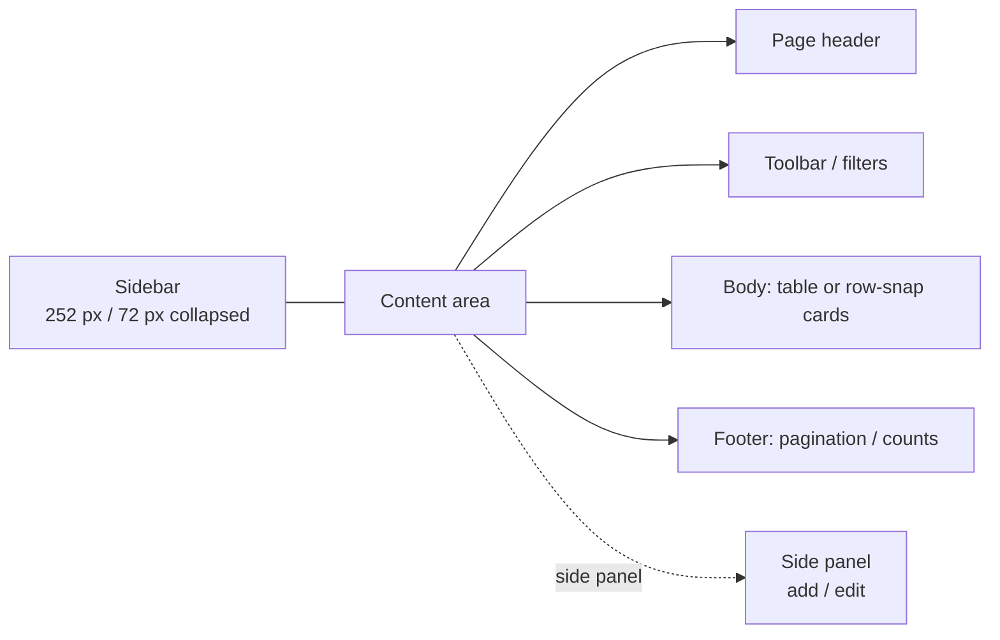

# MemonBooks – UI Design Standard

This document is the documented UI standard for MemonBooks. It describes what the code in `frontend/components/` actually contains, plus the colour palette supplied by the product owner and where the code still differs from it.

Related documents: [README](../README.md) · [PRD](prd.md) · [Architecture](architecture.md) · [Feature development](feature-development.md) · [Testing & QA](testing-qa.md)

## Table of contents

1. [Project rules](#1-project-rules)
2. [Fonts and icons](#2-fonts-and-icons)
3. [Type scale](#3-type-scale)
4. [Spacing, radii and responsive breakpoints](#4-spacing-radii-and-responsive-breakpoints)
5. [Colours](#5-colours)
6. [Palette vs code](#6-palette-vs-code)
7. [Layout patterns](#7-layout-patterns)
8. [Component catalogue](#8-component-catalogue)
9. [Accessibility](#9-accessibility)
10. [Keyboard support](#10-keyboard-support)
11. [Known limitations](#11-known-limitations)
12. [Open questions](#12-open-questions)

---

## 1. Project rules

These rules are enforced partly by review and partly by the regression test `tests/style_consistency/main.rs` (see [testing-qa.md](testing-qa.md)).

| # | Rule | Where it lives / how it is checked |
|---|------|------------------------------------|
| 1 | **All styles live only in `frontend/components/`.** Views (`frontend/views/`) compose components; they never define colours, borders or shadows themselves. | `views_and_components_source_all_styling_from_styles_rs` |
| 2 | **One feature = one function.** Each UI feature (a header, a toolbar, a card, a table row) is one reusable function in `components/`; a view calls it instead of rebuilding it. | Review |
| 3 | **No raw literals** for colour (`Color { .. }` / hex), font family, font size, padding/spacing numbers, hand-built `Border { .. }`, or `\u{...}` glyphs outside `components/`. `Color::WHITE`, `Color::BLACK`, `Color::TRANSPARENT`, a bare `0` padding, and `checkbox(..).size(16)` are the documented exceptions. | `tests/style_consistency` |
| 4 | **Icons only via `icons.rs`.** Each icon is a named constant holding one Lucide code point, drawn with `icons::icon(..)`; never with the text font. | `icons.rs` unit tests check each glyph exists in the font |
| 5 | **Font family is named only in `fonts.rs`.** | `only_fonts_rs_names_a_font_family` |
| 6 | **Row-snap card lists.** Card grids scroll by whole rows through `row_snap.rs`, so a card is never cut at the top or bottom. | `row_snap.rs` |
| 7 | **Shared page card.** Vendors, Bank Accounts and Warehouses build their page with `panels::page_card` (one outer rounded card: header, body, optional footer). | `vendors_bank_accounts_and_warehouses_build_their_page_with_the_shared_page_card` |
| 8 | **Responsive breakpoints come from `spacing.rs`** (`BREAKPOINT_NARROW`, `BREAKPOINT_WIDE`, `BREAKPOINT_XWIDE`); pages never hard-code widths. | `spacing::layout_class` |
| 9 | **Type scale comes from `typography.rs`**; sizes are never typed inline. | `tests/style_consistency` |
| 10 | **No popups.** Create, edit and detail flows use a side panel or a full detail page with a **Back** button. (Native OS file dialogs for import/attach are the only external windows.) | Convention. `modal.rs`, `dialogs.rs` and `confirmation.rs` are unused stubs (`// TODO`) |
| 11 | **Field names written once.** Vendor columns, bank fields and warehouse fields are each written in exactly one constant array. | `*_field_names_are_written_only_in_*` tests |
| 12 | **Money is never `f32`/`f64`.** Display only; values are `rust_decimal::Decimal` (stored as TEXT in SQLite). | `PROJECT_SPEC.md`, [database.md](database.md) |

## 2. Fonts and icons

| Asset | File | Licence | Rust constant |
|-------|------|---------|---------------|
| Pragati Narrow Regular (Latin subset) | `assets/fonts/pragati-narrow/static/pragati-narrow-latin-400-normal.ttf` | SIL OFL 1.1 (`assets/fonts/pragati-narrow/LICENSE`) | `fonts::DEFAULT`, bytes `REGULAR_TTF` |
| Pragati Narrow Bold (Latin subset) | `.../pragati-narrow-latin-700-normal.ttf` | SIL OFL 1.1 | `fonts::BOLD`, bytes `BOLD_TTF` |
| Lucide icon font | `assets/fonts/lucide.ttf` | ISC (`assets/fonts/LICENSE-lucide.txt`) | `fonts::ICONS`, bytes `ICONS_TTF` |

* All three are embedded with `include_bytes!` (`fonts::EMBEDDED`) and loaded once at start-up in `src/main.rs`, so nothing is read from the system at runtime.
* `Pragati Narrow` is set as the application default font; every widget without an explicit `.font()` uses it. `BOLD` resolves to the real Bold face, not a synthesised one.
* `icons.rs` holds 43 icon constants (for example `ADD`, `SEARCH`, `EXPORT`, `EDIT`, `REMOVE`, `ARROW_LEFT`, `ATTACH`, `SUN`, `MOON`, `KEBAB`).
* `fonts::button_size()` and `fonts::label_size()` both return `typography::label()`.

## 3. Type scale

All sizes are base values multiplied by **two** factors in `font_scale::scaled(base)`:

```
size = base × user Font Size multiplier × window-width factor
```

User Font Size (Settings, persisted to `font_scale_preference.txt`):

| Choice | Multiplier |
|--------|-----------:|
| Small | 0.875 |
| Medium (default) | 1.0 |
| Large | 1.125 |
| Extra Large | 1.25 |

Window-width factor (`font_scale::width_factor`, from the shared breakpoints):

| Window width | Factor |
|--------------|-------:|
| < 800 px | 0.9 |
| 800 – < 1200 px | 1.0 |
| 1200 – < 1700 px | 1.1 |
| ≥ 1700 px (about a 1920 screen) | 1.2 |

Base sizes in `typography.rs` (Medium, 800–1199 px window):

| Function | Base size (px) | Used for |
|----------|---------------:|----------|
| `micro()` | 10 | smallest text |
| `filter_count()` | 11 | count pills/badges ("12 Total") |
| `caption()` | 12 | secondary/subtitle text |
| `small()` | 13 | dense secondary lines |
| `profile_name()` | 13.5 | sidebar user name (not part of the monotonic-scale test) |
| `body()` / `BASE_BODY` | 14 | default body text, field labels |
| `label()` | 15 | button labels, inputs, table cells, toolbar controls |
| `emphasis()` | 16 | emphasised text, small icon glyphs |
| `form_input()` | `body() + 2` = 16 | text inside detail-form inputs/dropdowns |
| `panel_title()` | 17 | in-panel/card heading |
| `app_name()` | 17 | sidebar brand text |
| `subtitle()` | 22 | sub-heading of a block on a page |
| `title()` | 28 | standalone page title |
| `stat_value()` | 28 | dashboard stat numbers |
| `display()` | 34 | hero figure / opening heading |
| `checkbox_size()` | 16 (fixed, not scaled) | checkbox box dimension, not a text size |

Controls grow with the type scale through `spacing::grown(base)` (`base × body() / 14`): `card_height()` (220), `icon_button_size()` (36), `icon_box_size()` (44), `grid_cell_size()` (28), `page_button_width()` (32), `table_row_height()` (52).

## 4. Spacing, radii and responsive breakpoints

Spacing tokens (`spacing.rs`):

| Token | px | Token | px |
|-------|---:|-------|---:|
| `SPACE_1` | 1 | `SPACE_14` | 14 |
| `SPACE_2` | 2 | `SPACE_18` | 18 |
| `SPACE_4` / `XS` | 4 | `SPACE_20` | 20 |
| `SPACE_5` | 5 | `SPACE_24` / `LG` | 24 |
| `SPACE_6` | 6 | `SPACE_30` | 30 |
| `SPACE_8` / `SM` | 8 | `XL` | 32 |
| `SPACE_10` | 10 | `SPACE_40` | 40 |
| `SPACE_12` | 12 | `MD` | 16 |

Page padding: `HEADER_PADDING` = 24/24/0/24 (top/right/bottom/left); `CONTENT_PADDING` = 0/24/24/24.
Other fixed sizes: `SCROLLBAR_WIDTH` 8, `SEARCH_WIDTH` 260, `SEARCH_MIN_WIDTH` 140, `BUTTON_MIN_WIDTH` 72, `TABLE_ROW_HEIGHT` 52, `SUMMARY_PANEL_WIDTH` 260, `PANEL_MIN_WIDTH` 420, `PANEL_TWO_COLUMN_MIN_WIDTH` 520, sidebar `EXPANDED_WIDTH` 252 / `COLLAPSED_WIDTH` 72.

Corner radii (`states.rs`): `RADIUS_SM` 6, `RADIUS_MD` 10, `RADIUS_LG` 14, `RADIUS_PILL` 999.

Breakpoints:

| Class | Width | Card grid columns | Side panel |
|-------|-------|:-----------------:|------------|
| `Narrow` | < 800 | 1 | replaces the content while open |
| `Medium` | 800 – < 1200 | 2 | 45 % of the page, never < 420 px, beside the content |
| `Wide` | ≥ 1200 | 3 | 1/3 of the page, never < 420 px, beside the content |
| (type scale only) | ≥ 1700 | 3 | type scale grows once more (factor 1.2) |

A panel at least 520 px wide lays its fields out in two columns. `spacing::panel_split(inner, panel_open, gap)` computes the split.

Card grids show `VISIBLE_CARD_ROWS` = 2 whole rows when the height allows (never below one); a row may stretch up to `CARD_STRETCH_MAX` = 1.5× `card_height()`; rows are `ROW_GAP` = 16 apart.

State alphas (`states.rs`): solid-button hover 0.85, neutral-control hover 0.6, outline-button hover 0.1, ghost-row hover 0.06, selected 0.14, tinted panel 0.08, table-row hover 0.5, textbox selection tint 0.25, disabled 0.45 (0.65 on dark). `Theme::tint_alpha` doubles a tint alpha on dark (max 1.0).

## 5. Colours

Colours are `Theme` methods in `frontend/components/colors.rs` (enum `Theme { Light, Dark }`). The theme is detected once at launch with `dark-light`, can be toggled with the sidebar sun/moon button, and is persisted to `theme_preference.txt` in the data directory.

### 5.1 Dark theme – product owner palette (target)

| Group | Token | Hex | RGB |
|-------|-------|-----|-----|
| General | Primary Background | `#1D1D20` | 29, 29, 32 |
| General | Primary Click/Active Background | `#39393D` | 57, 57, 61 |
| General | Primary Hover Background | `#2D2D31` | 45, 45, 49 |
| General | Primary Border | `#46464B` | 70, 70, 75 |
| General | Primary Font | `#FFFFFF` | 255, 255, 255 |
| Navigation | Background | `#39393D` | 57, 57, 61 |
| Navigation | Bar | `#46464B` | 70, 70, 75 |
| Navigation | Hover | `#4B4B51` | 75, 75, 81 |
| Navigation | Active | `#55555C` | 85, 85, 92 |
| Positive status | Font | `#006100` | 0, 97, 0 |
| Positive status | Background | `#C6EFCE` | 198, 239, 206 |
| Negative status | Font | `#9C0006` | 156, 0, 6 |
| Negative status | Background | `#FFC7CE` | 255, 199, 206 |

### 5.2 Dark theme – values currently in the code

| Method | Hex | Notes |
|--------|-----|-------|
| `page_bg` | `#222226` (34,34,38) | |
| `surface` | `#1E1E22` | marked `PLACEHOLDER` in code; sidebar and cards |
| `surface_hover` | `#1F2937` | table header, scrollbar track |
| `text_primary` | `#F2F2F5` | `PLACEHOLDER` |
| `neutral_bg` | `#3A3D44` | status pills, dividers |
| `neutral_bg_hover` | `#6B7280` | |
| `neutral_font` | `#B5B5B5` | button label on neutral controls |
| `neutral_front` | `#B7BDC6` | `PLACEHOLDER`; muted text, inactive nav |
| `neutral_border` | `#74747C` | |
| `neutral_border_hover` | `#FFFFFF` | |
| `primary` | `#7B8699` | accent; active nav item font |
| `primary_hover` | `#5F697A` | |
| `secondary` / `secondary_hover` | `#4B5563` / `#6B7280` | |
| `add` / `add_hover` | `#FF8904` / `#FF9D2E` | same as light |
| `positive_bg` / `positive_bg_hover` / `positive_front` | `#164A2B` / `#16A34A` / `#7FE08C` | front is `PLACEHOLDER` |
| `negative_bg` / `negative_bg_hover` / `negative_front` | `#5A1E24` / `#DC2626` / `#FF8A93` | front is `PLACEHOLDER` |
| `warning_bg` / `warning_front` | `#3A2E0A` / `#FFD166` | both `PLACEHOLDER` |
| `header_bg` / `header_bg_hover` / `header_front` | `#EF4444` / `#DC2626` / `#FF8A93` | |
| `accent_front` | `#FFFFFF` | label on filled accent buttons |

### 5.3 Light theme (`Theme::Light`)

| Method | Hex |
|--------|-----|
| `page_bg` / `surface` | `#FFFFFF` |
| `surface_hover` | `#F8FAFC` |
| `text_primary` | `#000000` |
| `neutral_bg` | `#E5E7EB` |
| `neutral_bg_hover` | `#F8FAFC` |
| `neutral_font` | `#111827` |
| `neutral_front` | `#4B5563` |
| `neutral_border` | `#EBEBEB` |
| `neutral_border_hover` | `#2C8FBD` |
| `primary` / `primary_hover` | `#51A2FF` / `#56AED7` |
| `secondary` / `secondary_hover` | `#6B7280` / `#4B5563` |
| `add` / `add_hover` | `#FF8904` / `#FF9D2E` |
| `positive_bg` / `positive_bg_hover` / `positive_front` | `#C6F1CE` / `#16A34A` / `#006400` |
| `negative_bg` / `negative_bg_hover` / `negative_front` | `#FFC8CE` / `#DC2626` / `#9C000A` |
| `warning_bg` / `warning_front` | `#FFEBA0` / `#9C5A00` |
| `header_bg` / `header_bg_hover` / `header_front` | `#FFC8CE` / `#DC2626` / `#9C000A` |

The light palette is locked by the unit test `light_theme_matches_the_original_white_theme_values`.

### 5.4 Table and scrollbar values (`table.rs`, `scrollbar.rs`)

| Function | Light | Dark (derivation → resulting value) |
|----------|-------|--------------------------------------|
| `border_color` | `#D1D5DB` | `neutral_border` → `#74747C` |
| `header_background` | `#F8FAFC` | `surface_hover` → `#1F2937` |
| `hover_background` | `#F0F9FF` | `primary_tint(0.18)` → `#7B8699` at alpha 0.36 |
| `divider_color` / `grid_line_color` | `#F0F2F5` | `neutral_bg` → `#3A3D44` |
| `scrollbar_track` | `#F8FAFC` | `surface_hover` → `#1F2937` |
| `scrollbar_thumb` | `#56AED7` | `primary_hover` → `#5F697A` |
| `scrollbar_thumb_hover` | `#2C8FBD` | `primary` → `#7B8699` |

Scrollbars are 8 px wide (`SCROLLBAR_WIDTH`) in their own 8 px gutter so they never paint over content; the row-snap bar is a vertical slider with a rounded rail and a 40 px thumb (`scrollbar::row_track`).

## 6. Palette vs code

Comparison of the dark values above (section 5.1) with the dark values in the code (section 5.2). **The code was not changed**; this is a report. "Closest token" is the existing method that plays the same role.

| Owner token | Owner value | Closest code token (dark) | Code value | Match |
|-------------|-------------|---------------------------|------------|:-----:|
| Primary Background | `#1D1D20` | `page_bg` | `#222226` | ✗ (+5,+5,+6) |
| Primary Background (cards/sidebar) | `#1D1D20` | `surface` | `#1E1E22` | ✗ (+1,+1,+2), placeholder |
| Primary Click/Active Background | `#39393D` | `neutral_bg` (pressed/selected pills) | `#3A3D44` | ✗ |
| Primary Hover Background | `#2D2D31` | `surface_hover` | `#1F2937` | ✗ (blue-tinted) |
| Primary Border | `#46464B` | `neutral_border` | `#74747C` | ✗ (much lighter) |
| Primary Font | `#FFFFFF` | `text_primary` | `#F2F2F5` | ✗ (placeholder) |
| Navigation Background | `#39393D` | `surface` (sidebar container) | `#1E1E22` | ✗ |
| Navigation Bar | `#46464B` | — (sidebar uses `neutral_bg` divider `#3A3D44`) | — | ✗ no token |
| Navigation Hover | `#4B4B51` | — (nav rows have no dedicated hover background) | — | ✗ no token |
| Navigation Active | `#55555C` | `primary` used as active item *font* colour | `#7B8699` | ✗ different role |
| Positive font | `#006100` | `positive_front` | `#7FE08C` | ✗ (light-on-dark variant, placeholder) |
| Positive background | `#C6EFCE` | `positive_bg` | `#164A2B` | ✗ (dark green instead of pale) |
| Negative font | `#9C0006` | `negative_front` | `#FF8A93` | ✗ (placeholder) |
| Negative background | `#FFC7CE` | `negative_bg` | `#5A1E24` | ✗ (dark red instead of pale) |

Result: **0 of 14 tokens match**; 12 differ in value and 2 (Navigation Bar, Navigation Hover) have no corresponding token at all. Navigation has no dedicated tokens: `sidebar.rs` uses `surface`, `neutral_bg`, `neutral_front` and `primary`.

Additional differences found while comparing the owner status colours with the **light** theme in the code (the owner values are the classic spreadsheet "Good/Bad" colours):

| Owner | Owner value | Light theme in code | Code value |
|-------|-------------|---------------------|------------|
| Positive font | `#006100` | `positive_front` | `#006400` |
| Positive background | `#C6EFCE` | `positive_bg` | `#C6F1CE` |
| Negative font | `#9C0006` | `negative_front` | `#9C000A` |
| Negative background | `#FFC7CE` | `negative_bg` | `#FFC8CE` |

The product-owner status pairs look like light-theme values; whether they should also be used unchanged on the dark theme is an [open question](#12-open-questions). Note that the owner pairs would give a pale chip on a dark page (fine for contrast, see [section 9](#9-accessibility)).

## 7. Layout patterns

### 7.1 App shell



The sidebar (`sidebar.rs`) has a brand row, a scrolling navigation list (primary routes, divider, secondary routes), a profile card and the theme toggle. Routes are listed in `src/main.rs` (`NAV_ITEMS`).

### 7.2 Page header

`page_header.rs`: title and description on the left, search box and the primary action button ("+ Add …") on the right. The search box shrinks to `SEARCH_MIN_WIDTH` (140) and buttons never narrower than `BUTTON_MIN_WIDTH` (72), so labels never wrap. Variants exist with a view switcher and with a custom action style. `page_header::detail` is the header of a detail page and carries the **Back** button (`icons::ARROW_LEFT`).

### 7.3 Toolbar

`toolbar.rs` (`view`, `list_toolbar`, `card_header`, `filter_bar`): status filter chips with counts (`filter_count` size), column chooser, reset and export buttons, sized to `toolbar::control_height()`.

### 7.4 Table

`table.rs` / `data_table.rs`: bordered rounded card (`RADIUS_LG`), header row with sortable headings (`sort_header`), 52 px rows rendered as buttons for hover feedback, 1 px dividers, optional select-box column (44 px) and action column (48 px) with a kebab menu. A header aligned above a scrolled body reserves `SCROLLBAR_WIDTH` on its right.

### 7.5 Card list (row-snap)

Vendors, Bank Accounts and Warehouses show cards in a grid (3/2/1 columns). `row_snap::RowSnap` keeps `first_row` in page state; mouse wheel, trackpad and the scrollbar all move whole rows (`Scroll::Lines`, `Scroll::Pixels`, `Scroll::ToRow`, 40 px of trackpad = one notch). The grid is drawn in a bounded-height `responsive` region between toolbar and footer, inside `panels::page_card(theme, header, body, footer)`.

### 7.6 Side panel

`side_panel.rs` (`card`, `split`) places the add/edit form next to the list on Medium and Wide pages (see [section 4](#4-spacing-radii-and-responsive-breakpoints)); on Narrow pages the panel replaces the list. Forms use `forms.rs`, `input_field.rs`, `dropdown.rs`, `datepicker.rs`.

### 7.7 Detail page with Back

A full-page view (for example a warehouse layout) uses `page_header::detail` with a Back button; Back returns to the list with its state (filters, `RowSnap` position) intact.

### 7.8 No popups

Results and errors are shown inline in the page or panel (`state.message` / `state.error` in the views), not in a modal. No view uses `modal`, `dialogs` or `confirmation`. Native OS file pickers (`rfd`) are used for import and attachments.

## 8. Component catalogue

`frontend/components/` contains: `badges`, `borders`, `bulk_action_bar`, `button`, `calendar`, `checkbox`, `colors`, `combobox`, `confirmation`, `data_table`, `datepicker`, `dialogs`, `dropdown`, `font_scale`, `fonts`, `forms`, `frames`, `headers`, `icons`, `input_field`, `inputs`, `labels`, `list`, `loading`, `menu`, `modal`, `notification`, `page_header`, `pagination`, `panels`, `radiobutton`, `row_snap`, `scrollbar`, `search`, `section_heading`, `separators`, `shadows`, `sidebar`, `side_panel`, `spacing`, `states`, `statusbar`, `table`, `tabs`, `textbox`, `theme`, `toolbar`, `tooltip`, `tree`, `typography`.

## 9. Accessibility

### 9.1 Contrast (WCAG 2.x, calculated)

Ratios are computed with the WCAG relative-luminance formula. AA requires 4.5:1 for normal text and 3:1 for large text and UI boundaries.

**Product-owner dark palette**

| Pair | Ratio | Verdict |
|------|------:|---------|
| Primary Font `#FFFFFF` on Primary Background `#1D1D20` | **16.82:1** | AAA |
| Primary Font on Click/Active `#39393D` | **11.50:1** | AAA |
| Primary Font on Hover `#2D2D31` | **13.71:1** | AAA |
| Primary Font on Navigation Background `#39393D` | **11.50:1** | AAA |
| Primary Font on Navigation Bar `#46464B` | **9.38:1** | AAA |
| Primary Font on Navigation Hover `#4B4B51` | **8.66:1** | AAA |
| Primary Font on Navigation Active `#55555C` | **7.39:1** | AAA |
| Positive font `#006100` on `#C6EFCE` | **6.14:1** | AA |
| Negative font `#9C0006` on `#FFC7CE` | **5.92:1** | AA |
| Primary Border `#46464B` on Primary Background | **1.79:1** | below the 3:1 non-text guideline |

**Values currently in the code**

| Pair | Ratio | Verdict |
|------|------:|---------|
| Dark `text_primary` `#F2F2F5` on `page_bg` `#222226` | 14.19:1 | AAA |
| Dark `neutral_front` `#B7BDC6` on `page_bg` | 8.38:1 | AAA |
| Dark `positive_front` `#7FE08C` on `positive_bg` `#164A2B` | 6.32:1 | AA |
| Dark `negative_front` `#FF8A93` on `negative_bg` `#5A1E24` | 5.66:1 | AA |
| Dark `warning_front` `#FFD166` on `warning_bg` `#3A2E0A` | 9.25:1 | AAA |
| Dark `primary` `#7B8699` (active nav) on sidebar `surface` `#1E1E22` | 4.52:1 | AA (just) |
| Dark `neutral_border` `#74747C` on `page_bg` | 3.42:1 | passes 3:1 |
| Dark white label on `primary` button `#7B8699` | 3.68:1 | large text only |
| Light `text_primary` `#000000` on white | 21.00:1 | AAA |
| Light `neutral_front` `#4B5563` on white | 7.56:1 | AAA |
| Light `positive_front` `#006400` on `#C6F1CE` | 5.98:1 | AA |
| Light `negative_front` `#9C000A` on `#FFC8CE` | 5.96:1 | AA |
| Light `warning_front` `#9C5A00` on `#FFEBA0` | 4.55:1 | AA (just) |
| Light `primary` `#51A2FF` on white | 2.64:1 | **fails** as text / UI boundary |
| Light white label on `primary` button `#51A2FF` | 2.64:1 | **fails** AA for normal text |

Reproduce: the script used is a 20-line WCAG luminance calculation; any equivalent calculator gives the same values.

### 9.2 Other accessibility facts

* Text size can be changed by the user (Small … Extra Large) and grows with the window width; controls grow with it (`spacing::grown`).
* Status pills combine colour with a leading dot icon (`STATUS_DOT`) and, by design, the status word (not audited for every screen).
* Disabled controls stay readable (opacity 0.45 light, 0.65 dark).
* There is no screen-reader integration: iced 0.13 does not expose an accessibility tree. This is a platform limitation, not a project decision.
* No high-contrast theme exists.

## 10. Keyboard support

**There is no application-level key handler.** The code contains no `keyboard::on_key_press`, no `Key::` matching and no keyboard subscription in `src/main.rs` or `frontend/` (the only `subscription` is in the test-only binary `native_ui_check`). Consequences:

* No shortcuts (save, new, search, close panel, navigate list).
* No documented or tested Tab order. Whatever iced 0.13 provides by default for focused `text_input` widgets (typing, caret, selection, clipboard) works; focus traversal of other widgets was not verified.
* Enter-to-submit: `on_submit` is set in only one place in `frontend/`.

Treat keyboard accessibility as **Planned**.

## 11. Known limitations

| Limitation | Detail |
|------------|--------|
| **Pragati Narrow has no Urdu/Arabic glyphs** | The embedded files are Latin subsets ("Basic Latin + Latin-1 + common punctuation/currency"). Urdu and Arabic text would render as missing glyphs or a system fallback. `frontend/i18n/{en,ur,ar}.rs` are one-line stubs, so no translated UI exists yet. |
| **No Rupee sign (₹ U+20B9, or Pakistani Rupee ₨ U+20A8) glyph** | Not present in the Latin subset. Currency is shown by code (for example `PKR`, `USD`) or text, never by the symbol. |
| No right-to-left layout | iced 0.13 has no RTL layout support. |
| Light-theme `primary` (`#51A2FF`) has 2.64:1 contrast against white | See [section 9](#9-accessibility). |
| Dark theme still contains `PLACEHOLDER` tokens | See [section 6](#6-palette-vs-code). |
| Live OS theme switching is not supported | Theme is detected at launch only (`dark-light` offers a one-shot `detect()`); use the manual toggle. |

## 12. Open questions

1. Should the dark theme in code be changed to the product-owner palette (all 14 tokens differ today)? Who decides, and when?
2. Navigation needs three new tokens (Bar, Hover, Active) if the owner palette is adopted; naming not decided.
3. Are the owner status colours (`#006100/#C6EFCE`, `#9C0006/#FFC7CE`) meant to be used unchanged on the dark theme, or are they the light-theme values?
4. `modal.rs`, `dialogs.rs` and `confirmation.rs` are `// TODO` stubs that no view uses; remove them or keep them reserved?
5. Is a Pragati Narrow build with Urdu/Arabic coverage (or a second bundled font) planned? Which Rupee representation should be used?
6. Which keyboard shortcuts and tab order are required (Planned)?
7. `typography.rs` comments mention open questions about `headers::page_title_size()`; the `headers.rs` size constants were not audited for this document.
