# MemonBooks – Feature Development Guide

How to add or change a feature without breaking the architecture or the UI standard. Read [architecture.md](architecture.md) and [design.md](design.md) first.

Related documents: [README](../README.md) · [PRD](prd.md) · [Database](database.md) · [API](api.md) · [Testing & QA](testing-qa.md) · [Security](security.md)

## Table of contents

1. [Ground rules](#1-ground-rules)
2. [Workflow](#2-workflow)
3. [Step-by-step: a new master-data list page](#3-step-by-step-a-new-master-data-list-page)
4. [Adding a database change](#4-adding-a-database-change)
5. [Adding a service method](#5-adding-a-service-method)
6. [Adding or changing UI components](#6-adding-or-changing-ui-components)
7. [Adding a route (sidebar entry)](#7-adding-a-route-sidebar-entry)
8. [Adding a report or export](#8-adding-a-report-or-export)
9. [Adding a permission](#9-adding-a-permission)
10. [Definition of done](#10-definition-of-done)
11. [Commit conventions](#11-commit-conventions)
12. [Open questions](#12-open-questions)

---

## 1. Ground rules

1. **Do not restructure the frozen folder layout** (`PROJECT_SPEC.md` §2). Add files in the most consistent existing place.
2. **Layering:** `View → Service → Repository → Database`. A view never contains SQL or accounting rules.
3. **Money is `rust_decimal::Decimal`**, stored as TEXT. Never `f32`/`f64`.
4. **Every posted entry balances**; this is enforced in `transaction_engine`, not in the UI. Posted rows are never edited – reverse them.
5. **All styling lives in `frontend/components/`**; no raw colour/font/size/padding/glyph literals elsewhere ([design.md](design.md#1-project-rules)). One feature = one function.
6. **Never edit an applied migration.** Add a new one with a unique version.
7. **No lint suppression** (`#[allow(..)]`) to make a build pass; fix the cause.
8. **No popups**: use a side panel or a detail page with a Back button.
9. Write the test with the feature, not afterwards.

## 2. Workflow

```mermaid
flowchart LR
    A[Spec: PRD / issue] --> B[Schema: new migration]
    B --> C[Domain model + Validate]
    C --> D[Repository SQL + tests]
    D --> E[Service method]
    E --> F[Component additions in frontend/components]
    F --> G[View: State / Message / update / view]
    G --> H[Route in src/main.rs]
    H --> I[Tests + style_consistency]
    I --> J[Manual check, both themes, 3 widths]
    J --> K[CHANGELOG + docs + commit]
```



## 3. Step-by-step: a new master-data list page

Use `frontend/views/accounting/maintain/warehouse_view.rs` (cards + side panel + detail) and `vendors_view.rs` as the reference implementations. Example: a hypothetical "Price Lists" page.

1. **Spec** – decide fields, validation, whether it is company-scoped, whether deleting archives (see `BankingService::remove_bank_account → Removal::{Deleted, Archived}`).
2. **Migration** – section 4.
3. **Domain** – `backend/<area>/price_lists.rs`: struct + `impl Validate` using `require_non_empty`, `require_max_length`, `require_positive`.
4. **Repository** – `PriceListRepository::new(db)`, CRUD with `params![]`, translate `is_constraint_violation()` into a clear message.
5. **Service** – `PriceListService::new(db)` with `list(company_id)`, `create`, `update`, `delete`.
6. **Components** – if a new visual element is needed, add **one function** to the matching component file (or a new file listed in `components/mod.rs`). Reuse first: `panels::page_card`, `page_header`, `toolbar`, `row_snap`, `side_panel`, `forms`, `badges`, `button`.
7. **View skeleton**

   ```rust
   pub struct State { rows: Vec<PriceList>, form: PriceListForm, panel_open: bool,
                      snap: RowSnap, error: Option<String>, message: Option<String> }

   #[derive(Debug, Clone)]
   pub enum Message { Search(String), Add, Edit(i64), Save, Cancel, Delete(i64),
                      Scrolled(row_snap::Scroll), Export }

   pub fn load(ctx: &Ctx) -> State { /* service.list(ctx.company_id) */ }
   pub fn update(state: &mut State, message: Message, ctx: &Ctx) { /* match; call service; set error/message */ }
   pub fn view(state: &State, theme: Theme) -> Element<'_, Message> {
       panels::page_card(theme, header, body, Some(footer))   // shared page card
   }
   ```

   Read widths with `responsive` and decide columns with `spacing::layout_class` / `spacing::grid_columns`; use `spacing::panel_split` for the side panel.
8. **Field names** – put column/field names in one `const` array and use it for headers, forms and CSV export (the style test enforces this for vendors, banks and warehouses).
9. **Export** – build `(headers, rows)` and call `csv::export_csv`, write via `ctx.export_path("price_lists.csv")`.
10. **Route** – section 7.
11. **Tests** – repository/service test in `tests/<area>/main.rs` (in-memory DB); view `update()` tests in the view file; a `view()` construction test if you touched sizing ([testing-qa.md](testing-qa.md#6-view-construction-tests-iced)).

## 4. Adding a database change

1. Pick a free version number. List used numbers with `command grep -rn "version: [0-9]" backend database` (current maximum: 2000). Numbers are one global namespace.
2. Add a `Migration { version, name, sql }` to the owning repository's `MIGRATIONS` (new table or `ALTER TABLE … ADD COLUMN`). For a new area, add a `pub const MIGRATIONS` and register it in `all_migrations()` in `src/lib.rs`.
3. Rules for the SQL:
   * additive and nullable/defaulted so existing rows migrate (see 905, 1201, 1810);
   * money/quantity columns are `TEXT`;
   * `UNIQUE` on a new column cannot be added by `ALTER` in SQLite – use `CREATE UNIQUE INDEX … WHERE col IS NOT NULL` (see 501, 902, 1401);
   * declare foreign keys; `company_id` on business tables.
4. Test: a repository test on `Database::open_in_memory()` plus run the app once on a copy of a real database.
5. Update [database.md](database.md) (migration list, table, ER diagram).

## 5. Adding a service method

* Put the rule in the domain/engine or repository; the service orchestrates and (when required) checks permission: `self.require_permission(acting_user, KEY, "do X")?`.
* Return `AppResult<T>`; use `AppError::Validation` for user-correctable problems and `NotFound` for missing ids.
* For anything that touches the ledger, build a `Transaction` and let `AccountingRepository::post_transaction` validate and write it atomically together with the related rows.
* Document the method in [api.md](api.md).

## 6. Adding or changing UI components

* Prefer composing existing components. A new component is **one function** with the theme as its first argument, returning `Element`/a style closure.
* Take colours only from `Theme` methods or `table::*` helpers; sizes from `typography::*`; paddings from `spacing::*`; radii from `states::RADIUS_*`; icons from `icons::*`; fonts from `fonts::*`.
* Need a new colour? Add a method to `colors.rs` with both `Light` and `Dark` arms (the existing unit test fails if a Dark arm copies the light value). Check the contrast ([design.md](design.md#9-accessibility)).
* Need a new icon? Add a constant in `icons.rs` using a code point that exists in `assets/fonts/lucide.ttf`; the icons test verifies it.
* Controls that hold text must grow with the type scale: use `spacing::grown(..)` or the helpers (`icon_button_size()`, `table_row_height()`).
* Run `cargo test --test style_consistency -j 1`.

## 7. Adding a route (sidebar entry)

In `src/main.rs`: add a variant to `Route`, an entry to `NAV_ITEMS`, a `State` field on `App`, a `Message` variant wrapping the view's message, the `update` arm that calls `view::update(&mut self.state, inner, &self.ctx)`, and the `view` arm that maps `view::view(&self.state, self.theme)`. Gate admin-only entries on `AuthService::has_permission` like the Users route.

## 8. Adding a report or export

1. Pure builder in `backend/reports/<name>.rs` that takes data and returns a struct with `to_rows() -> (Vec<&'static str>, Vec<Vec<String>>)`.
2. Data access through `ReportService`.
3. Screen button calls `csv::export_csv(&headers, &rows)` and writes to `ctx.export_path(file)`. XLSX/PDF helpers (`export_xlsx`, `export_pdf`) already exist with the same `(headers, rows)` shape but are not yet used by any screen.
4. Test the builder with a seeded in-memory database (`tests/reports`).

## 9. Adding a permission

Add the key to `KNOWN_PERMISSIONS` in `backend/core/permissions.rs` (format `area.action`), grant it to roles (the first-run Administrator receives every known key), **and enforce it** in the service with `require_permission` – a key that nothing checks protects nothing ([security.md](security.md#3-authorisation-roles-and-permissions)).

## 10. Definition of done

- [ ] Behaviour matches the PRD entry; status in [prd.md](prd.md) updated (Implemented / Partial / Planned).
- [ ] Migration, domain validation, repository, service in place; no SQL or accounting rule in the view.
- [ ] Unit/integration tests added and passing (`cargo test --test <target> -j 1`); `style_consistency` passes.
- [ ] `cargo check -j 1`, `cargo clippy -j 1 --all-targets`, `cargo fmt --check` clean, no new `#[allow]`.
- [ ] UI checked in light and dark, at narrow/medium/wide widths, with Font Size Small and Extra Large.
- [ ] Docs updated: [database.md](database.md), [api.md](api.md), [design.md](design.md) as applicable; `CHANGELOG.md` entry.

## 11. Commit conventions

History uses Conventional-Commits-style prefixes: `feat(scope): …`, `fix(scope): …`, `refactor(scope): …`, `docs: …`. Commit small, stage files by name (never `git add .`), do not amend published commits, and keep one logical change per commit.

## 12. Open questions

1. Should there be a feature template or generator for list pages (the vendor, bank and warehouse pages share a lot)?
2. Where should feature specifications live – `docs/prd.md` only, or one file per feature?
3. Branching and review process (pull requests, protected `main`) is not documented in the repository.
