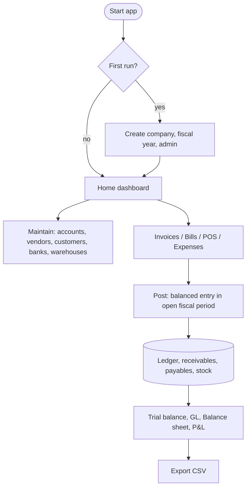

# MemonBooks – Product Requirements Document (PRD)

Status of this document: derived from the code in the repository, `PROJECT_SPEC.md`, `CHANGELOG.md` and the legacy-application guide `docs/Complete_Project_User_Guide.md`. It records what the product is **and what is actually built**. Requirements that appear only in the specification are marked *Planned*; nothing here is invented beyond those sources.

Related documents: [README](../README.md) · [Design](design.md) · [Architecture](architecture.md) · [Database](database.md) · [Security](security.md) · [Implementation status](project-implementation.md) · [Feature development](feature-development.md)

## Table of contents

1. [Product summary](#1-product-summary)
2. [Goals and non-goals](#2-goals-and-non-goals)
3. [Users and roles](#3-users-and-roles)
4. [Constraints](#4-constraints)
5. [Feature inventory and status](#5-feature-inventory-and-status)
6. [Key workflows](#6-key-workflows)
7. [Non-functional requirements](#7-non-functional-requirements)
8. [Success criteria](#8-success-criteria)
9. [Open questions](#9-open-questions)

---

## 1. Product summary

**MemonBooks** is a double-entry accounting and small-business ERP desktop application for Windows, Linux (and, per the specification, macOS). It runs fully offline on one computer, stores its data in a local SQLite file and is written in Rust with the iced GUI toolkit. It rebuilds, in a native stack, the feature set of an earlier Python/PyQt6 prototype documented in `docs/Complete_Project_User_Guide.md` (expenses, trips, purchase and sale documents, master data, payroll, ledger reports), adding a real accounting core.

Core promise: every financial figure comes from balanced, immutable ledger entries, and money is never handled as floating point.

## 2. Goals and non-goals

**Goals**

1. Correct double-entry bookkeeping with fiscal-period control and an audit trail.
2. Day-to-day business records: customers, vendors, items, warehouses, banks, employees.
3. Sales, purchases, POS, expenses, fixed assets, tax, payroll posting to the ledger.
4. Fast, consistent native UI that scales with window size and user font size, in light and dark themes.
5. No cloud dependency; user owns the data file.

**Non-goals** (from `PROJECT_SPEC.md` §1)

* No Electron, Tauri, Flutter, React, web front-end or browser runtime.
* No server or HTTP API ([api.md](api.md)).
* No multi-user concurrent network access (single local database).

## 3. Users and roles

| Role | Description | Status |
|------|-------------|--------|
| Administrator | First-run user `admin` with all permission keys; manages users, companies | Implemented |
| Other users | Created by an administrator, assigned a role, forced to change the temporary password | Implemented |
| Role-specific limits | Permission keys exist, only `users.manage` is enforced | Partial ([security.md](security.md)) |

Typical real-world users (accountant, shop manager, cashier, HR officer) are inferred from the modules; the code does not define such roles.

## 4. Constraints

* Rust only; iced only for the UI; SQLite embedded (`rusqlite` bundled).
* Decimal money (`rust_decimal`).
* Targets in the spec: Linux Flatpak, Microsoft Store (MSIX), macOS App Store. Only manifests exist ([architecture.md](architecture.md#11-binaries-and-packaging)).
* Pragati Narrow (Latin only) and Lucide are the bundled fonts, so Urdu/Arabic text and the rupee glyph are unsupported for now ([design.md](design.md#11-known-limitations)).
* The folder structure is frozen (`PROJECT_SPEC.md` §2).

## 5. Feature inventory and status

Legend: **Implemented** = backend, screen and tests exist · **Partial** = some layer is missing · **Planned** = specified or stubbed only.

### 5.1 Accounting core

| ID | Feature | Status | Evidence / gap |
|----|---------|--------|----------------|
| A1 | Companies (multi-company), default company and fiscal year at first run | Implemented | `OrganizationService`, `settings/companies_view` |
| A2 | Chart of accounts (parent/child, status, reference code, attachments) | Implemented | `maintain/chart_of_accounts_view`; cycle rejection; migrations 500–502 |
| A3 | Fiscal periods (Open → Closed → Locked) | Partial | creation and posting rules done; no screen to close/lock periods found |
| A4 | Manual journal entry, balanced-entry enforcement, posting, reversal | Implemented | `journal_entry_view`, `journal_entries_view`, `transaction_engine` |
| A5 | General ledger | Implemented | `ledger_view` |
| A6 | Trial balance (as-of date, CSV export) | Implemented | `trial_balance_view` |
| A7 | Opening balances, period closing entries | Partial | backend modules only (`opening_balances.rs`, `period_closing.rs`) |
| A8 | Audit log | Partial | written for ledger postings only |

### 5.2 Master data

| ID | Feature | Status | Evidence / gap |
|----|---------|--------|----------------|
| M1 | Vendors (profile, type, custom fields, attachments, CSV export, ledger) | Implemented | `maintain/vendors_view`, migrations 900–905 |
| M2 | Customers | Implemented | `maintain/customers_view` |
| M3 | Bank accounts (profile fields, opening balance, archive when in use) | Implemented | `maintain/bank_of_accounts_view`, migrations 1200–1201 |
| M4 | Warehouses with line/position bin layout and stock placement | Implemented | `maintain/warehouse_view`, migration 1810 |
| M5 | Items / products (SKU, barcode, prices) | Implemented | `inventory/products_view` |
| M6 | Item categories, stock adjustments and stock-movement screens | Planned | view files are empty |
| M7 | Bulk CSV import of master data | Partial | `DocumentService::import` + CSV/XLSX reader tested; no screen calls it |
| M8 | Attachments | Partial | vendors (and accounts' table) only; no limits ([security.md](security.md#8-files-attachments-imports-exports)) |

### 5.3 Transactions

| ID | Feature | Status | Evidence / gap |
|----|---------|--------|----------------|
| T1 | Sales invoices, payments, void, credit notes, receivables | Implemented | `sales/invoices_view`, `SalesService` |
| T2 | Purchase bills, payments, void, debit notes, payables | Implemented | `inventory/bills_view`, `PurchaseService` |
| T3 | Quotations, purchase orders | Partial | backend models/tables; no screen |
| T4 | 23 generic document kinds (orders, challans, receipts, returns, vouchers, trips…) with templates, conversion and stock effects | Partial | `DocumentService`, `workflow_*` tables, `tests/workflows.rs`; only the dashboard reads them |
| T5 | Point of sale: terminals, sessions, cash drawer, multi-payment sales, barcode | Implemented | `pos/pos_view`, `SalesService` |
| T6 | Expenses and expense claims (approve / reject / reimburse) | Implemented | `hr/expenses_view`, `ExpenseService` |
| T7 | Fixed assets and depreciation | Implemented | `accounting/fixed_assets_view` |
| T8 | Tax rates; tax transactions | Implemented | `accounting/tax_rates_view`, migration 1400–1401. Invoice tax is not posted to a separate tax account (CHANGELOG / guide note) – Partial for tax posting |
| T9 | Bank reconciliation, cash management | Partial | backend modules only |

### 5.4 People

| ID | Feature | Status | Evidence / gap |
|----|---------|--------|----------------|
| H1 | Employees (profile, department, branch) | Implemented | `hr/employees_view` |
| H2 | Salary structures, payroll run posting, bulk payroll generation | Partial | `OrganizationService::post_payroll_run`, `DocumentService::generate_payroll`; no payroll screen |
| H3 | Attendance, leave | Partial | models/tables only |

### 5.5 Reporting and output

| ID | Feature | Status | Evidence / gap |
|----|---------|--------|----------------|
| R1 | Dashboard (totals, recent items, quick actions) | Implemented | `dashboard/dashboard_view` |
| R2 | Balance sheet, profit & loss with CSV export | Implemented | `reports/reports_view` |
| R3 | AR/AP open items, aging, statements, cash book, VAT summary, fixed-asset, inventory, sales, purchase, expense, banking reports | Partial | 20 report modules in `backend/reports/`; only a subset has a screen |
| R4 | CSV export from list screens | Implemented | `exports/csv.rs` |
| R5 | XLSX and PDF export | Partial | library functions with tests, no screen |
| R6 | Printing | Planned | not found in code |

### 5.6 Platform and administration

| ID | Feature | Status | Evidence / gap |
|----|---------|--------|----------------|
| P1 | Login, switch user, forced password change, user administration | Implemented | start-up currently skips login (development shortcut) |
| P2 | Two-factor (TOTP) | Partial | verification implemented and requested at login; no enrolment screen found |
| P3 | Role/permission administration | Partial | 6 keys, 1 enforced; no role editor found |
| P4 | Light/dark theme (OS detection + toggle), font size setting, responsive layout | Implemented | [design.md](design.md) |
| P5 | Backup and restore | Partial | backend + scheduler maths tested; no UI |
| P6 | Licensing / trial / activation | Partial | HMAC key signing and trial maths; not wired in |
| P7 | Notifications (e-mail, SMS, WhatsApp, reminders, templates) | Partial | data models only; no transport (no network crates) |
| P8 | Multi-currency (currencies, exchange rates, conversion) | Partial | tables and helpers; base currency per company; no UI |
| P9 | Localisation (English, Urdu, Arabic) | Planned | `frontend/i18n/*` are empty stubs; font lacks glyphs |
| P10 | Keyboard shortcuts and accessibility | Planned | no key handler ([design.md](design.md#10-keyboard-support)) |
| P11 | Settings: company settings, numbering, invoice, tax, accounting settings, sync | Planned | `backend/settings/*` are empty stubs |
| P12 | Packaging for Flatpak, MSIX, macOS | Partial | manifests only, not built |
| P13 | Demo data seeding | Implemented | `seed_demo_data`, `clear_demo_data` |

## 6. Key workflows

Acceptance rules that every posting workflow shares:

1. A posting is rejected unless debits equal credits, the fiscal period is open and the date lies inside it.
2. A payment cannot exceed the open balance.
3. Corrections are reversals, never edits.
4. A failed post leaves no partial data.

## 7. Non-functional requirements

| Area | Requirement | Status |
|------|-------------|--------|
| Correctness | Decimal arithmetic, atomic multi-table writes, tests per domain | Implemented |
| Performance | Responsive on a single-user database; no indexes beyond uniqueness | Not measured |
| Offline | No network access needed or used | Implemented |
| Portability | Windows and Linux builds; macOS targeted | Linux verified for this document |
| Usability | Responsive layout, adjustable font size, light/dark | Implemented |
| Accessibility | Contrast measured; no keyboard model or screen-reader support | Partial ([design.md](design.md#9-accessibility)) |
| Security | Argon2 passwords; see gaps | Partial ([security.md](security.md)) |
| Data safety | Backup procedure | Manual only |
| Maintainability | Frozen layout, enforced style rules, ~900 tests | Implemented |

## 8. Success criteria

* A new user can start the app, create master data, post an invoice, record a payment and obtain a balanced trial balance without leaving the application.
* All automated test targets pass ([testing-qa.md](testing-qa.md)).
* No unresolved item from the security gap list that affects authentication ([security.md](security.md#13-gaps-and-risks)) before distributing to other users.

## 9. Open questions

1. What is the first release scope: which *Partial* items (payroll screen, period close, backup UI, quotations, purchase orders) are mandatory?
2. Is the generic document workflow (T4) meant to replace the typed invoice/bill screens, or complement them?
3. Target markets and statutory requirements (sales tax, withholding tax, NTN/STRN fields appear in the customer import) – is a tax-posting design available?
4. Languages: is Urdu/Arabic UI a release requirement (needs a new font and RTL support)?
5. Pricing/licensing model (the activation code exists but is unused).
6. Which stores (Microsoft Store, Flatpak, macOS App Store) are the first release target?
7. Maximum data volumes the product must support.
