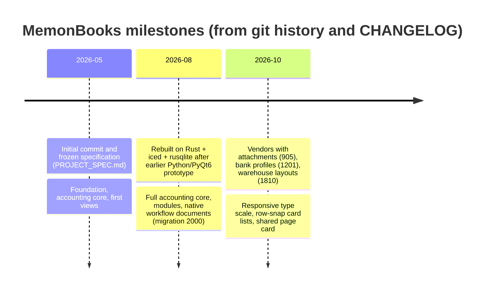

# MemonBooks – Project Implementation Status

What has been built, how it maps to the planned development order, and what remains. Facts come from the repository and its git history; see [prd.md](prd.md) for requirement-level status.

Related documents: [README](../README.md) · [PRD](prd.md) · [Architecture](architecture.md) · [Database](database.md) · [Testing & QA](testing-qa.md) · [Feature development](feature-development.md)

## Table of contents

1. [Snapshot](#1-snapshot)
2. [History](#2-history)
3. [Development order vs reality](#3-development-order-vs-reality)
4. [Codebase size and shape](#4-codebase-size-and-shape)
5. [Recently completed work](#5-recently-completed-work)
6. [Remaining work](#6-remaining-work)
7. [Known issues and technical debt](#7-known-issues-and-technical-debt)
8. [Related older documents](#8-related-older-documents)
9. [Open questions](#9-open-questions)

---

## 1. Snapshot

| Item | Value |
|------|-------|
| Package | `memonbooks` 0.1.0, Rust 2021, `stable` toolchain |
| Commits | 182 on `main` (first commit 2026-05-20) |
| Migrations | 29 (versions 300 … 2000) – [database.md](database.md#4-migration-list) |
| Tables | 74 application tables plus `schema_migrations` |
| Unit tests | about 850 `#[test]` functions in the crate, about 45 in 12 integration targets (counted by attribute) |
| Binaries | `memonbooks`, `seed_demo_data`, `clear_demo_data`, `native_ui_check` |
| Build state | `cargo check -j 1` passes (verified when this document was written) |
| UI rules guard | `tests/style_consistency` |

## 2. History

The dates are the first and recent activity in `git log`; intermediate phases are not tagged in the repository (no release tags found).

## 3. Development order vs reality

`PROJECT_SPEC.md` §5 fixes 20 steps. Status of each, judged from the code:

| # | Step | Status | Notes |
|--:|------|--------|-------|
| 1 | Cargo/iced foundation, theme | Implemented | now `frontend/components/` instead of the spec's `frontend/styles/` |
| 2 | Config, errors, logging, validation, database | Implemented | |
| 3 | Companies, branches, departments, currencies | Implemented | currencies have no UI |
| 4 | Users, auth, roles, permissions, sessions, 2FA | Partial | sessions/2FA enrolment not wired; login bypass at start-up |
| 5 | Chart of accounts, fiscal periods | Implemented | no period-close screen |
| 6 | Journal entries, transaction engine | Implemented | |
| 7 | General ledger, trial balance | Implemented | |
| 8 | Opening balances, period closing | Partial | backend only |
| 9 | Customers/vendors, AR/AP | Implemented | |
| 10 | Sales, purchases | Implemented | quotations/POs have no screens |
| 11 | Inventory, stock movements | Partial | products and warehouses done; stock screens empty |
| 12 | Banking, reconciliation | Partial | bank accounts done; reconciliation backend only |
| 13 | Expenses, fixed assets | Implemented | |
| 14 | Tax/VAT | Partial | rates done; invoice tax not posted separately |
| 15 | Reports, CSV/PDF/XLSX | Partial | CSV in UI; PDF/XLSX library only |
| 16 | POS | Implemented | |
| 17 | HR/payroll | Partial | no payroll/attendance/leave screens |
| 18 | Notifications, backup/restore, licensing | Partial | backend only |
| 19 | Iced views module by module | Partial | see PRD |
| 20 | Tests and packaging | Partial | tests broad; packaging manifests unbuilt |

## 4. Codebase size and shape

Lines of Rust (approximate, `wc -l`): the largest files are the Maintain views (`vendors_view.rs` ≈ 3,000, `bank_of_accounts_view.rs` and `warehouse_view.rs` ≈ 2,570 each), followed by `invoices_view.rs` (≈ 1,860) and `bills_view.rs` (≈ 1,810). Each contains its own unit tests.

Module groups ([architecture.md](architecture.md#3-source-layout)): `backend/` (domain, services, repositories), `database/`, `configs/`, `frontend/components` (≈ 50 files), `frontend/views`, `tests/`.

Stubs (empty or single-line files) are intentional placeholders from the frozen scaffold: `services/api.rs`, `commands.rs`, `transaction_service.rs`, `core/telemetry.rs`, `audit/activity_logs.rs`, `audit/change_history.rs`, `settings/*`, `frontend/i18n/*`, `components/modal.rs`, `dialogs.rs`, `confirmation.rs`, and the empty inventory view files.

## 5. Recently completed work

From the latest commits (`git log`):

| Commit | Change |
|--------|--------|
| `501fcde` | one shared `panels::page_card` for vendors, bank accounts and warehouses |
| `176a0fd` | row-snap shows two full card rows and scrolls one row per step |
| `c9d2075` | responsive app-wide type scale |
| `3fb49da` | row-snapping scroll area; fixes bottom overlap on bank and warehouse lists |
| earlier | vendor fields and attachments (905), bank account profile (1201), warehouse layouts/bins/placements (1810), Pragati Narrow and Lucide bundled fonts, light/dark theme, font-size setting |

`CHANGELOG.md` lists accounting fixes (overpayment rejection; credit and debit notes now post to the ledger).

## 6. Remaining work

Ordered by value; see the *Partial*/*Planned* rows in [prd.md](prd.md#5-feature-inventory-and-status).

1. **Security before distribution:** remove the start-up login bypass, enforce permissions, remove logging of the admin password, review the committed key-like files ([security.md](security.md#13-gaps-and-risks)).
2. **Backup/restore screen** and automatic schedule (backend exists).
3. **Fiscal period management screen** (close/lock) and opening balances.
4. **Payroll screen**, attendance and leave.
5. **Reports:** screens for AR/AP aging, statements, cash book, VAT, inventory, etc.; XLSX/PDF export buttons; printing.
6. **Import screens** for master data (CSV/XLSX).
7. **Tax posting** on invoices (policy decision needed).
8. **Quotation / purchase order screens**; decide the fate of the generic document workflow.
9. **Keyboard support and accessibility** pass; apply the product-owner dark palette ([design.md](design.md#6-palette-vs-code)).
10. **Localisation** (needs a font with Urdu/Arabic glyphs and RTL support).
11. **Packaging builds and store submission.**
12. **CI** (check, clippy, fmt, tests, dependency audit).

## 7. Known issues and technical debt

| Item | Where |
|------|-------|
| Start-up skips authentication | `src/main.rs::load_startup_user` |
| Dark theme has `PLACEHOLDER` tokens and differs from the owner palette | `colors.rs` |
| Two parallel data models for invoices/bills/documents (typed tables vs `workflow_*`) | migrations 1000/1001 vs 2000 |
| Large view files (2–3 k lines) | `vendors_view.rs`, `bank_of_accounts_view.rs`, `warehouse_view.rs` |
| `cargo run` needs `--bin memonbooks` (no `default-run`) | `Cargo.toml` |
| `PROJECT_SPEC.md` still says "MemomBooks" and `frontend/styles/` | spec is frozen; code uses `MemonBooks` and `frontend/components/` |
| Non-project files committed in the repo root | images, `Apis.txt`, key-like files ([security.md](security.md#9-secrets-logs-and-local-data)) |
| A few `#[allow(..)]` remain in the code (for example `clippy::too_many_arguments`, `module_inception`) | `purchase_service.rs`, `sales_service.rs`, `database/mod.rs` |
| No secondary indexes | [database.md](database.md#7-indexes-and-constraints-summary) |

## 8. Related older documents

| File | Note |
|------|------|
| `PROJECT_SPEC.md` | frozen specification (v1.0); source of the development order |
| `Project_Structure.txt` | structure listing, not updated here |
| `docs/Complete_Project_User_Guide.{md,pdf,docx}` | describes the **earlier Python/PyQt6 application** whose features are being rebuilt |
| `docs/RUST_IMPLEMENTATION.md` | point-in-time requirement checklist from an earlier review (780 tests at that time); parts are outdated and carry a notice at the top |
| `docs/design-reference/`, `docs/screenshots/` | reference images |
| `CHANGELOG.md` | behavioural changes |

## 9. Open questions

1. Is there a target date or version number for a first release (no tags exist)?
2. Should `PROJECT_SPEC.md` be amended (name spelling, `frontend/components/` instead of `frontend/styles/`)? It is marked frozen, so the owner must decide.
3. Which of the remaining-work items are in scope for the next milestone?
4. Is `docs/RUST_IMPLEMENTATION.md` to be regenerated from the current code?
5. Who owns release engineering (signing certificates, store accounts)?
